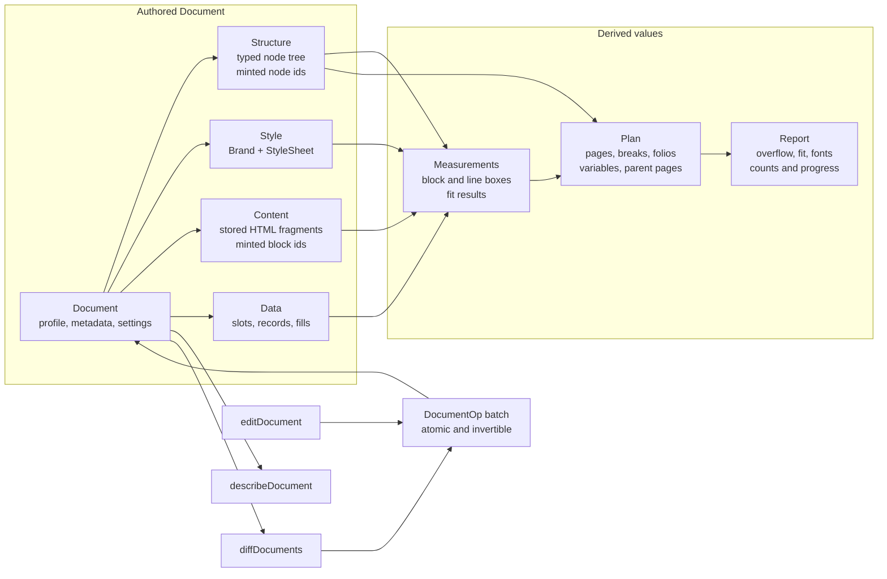
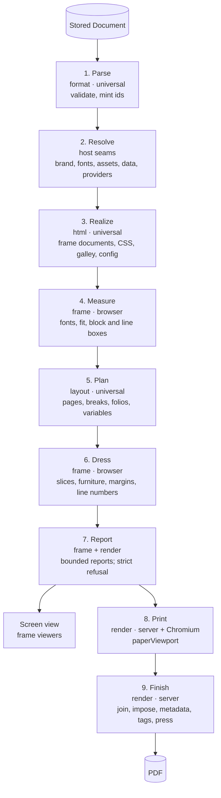
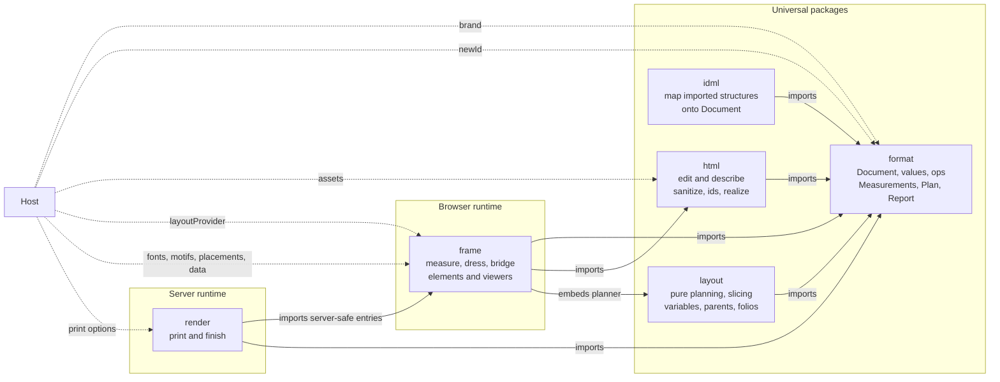

# Architecture

## Packages

```
format  ◄── html          (universal: browser and server)
  ▲       ▲
  └── idml ┘              (universal: IDML package import)
  ▲
  ├── layout              (universal: pure page planning, embeddable as frame script; html and frame import it)
  ├── frame ◄── diagrams  (browser; diagrams is optional and its payload is server-safe)
  │     ▲  ▲
  │     │  └── markdown-editor (browser; optional editor engines are required peers)
  │     └───── react      (browser adapter; React is a peer dependency here only; its markdown-editor subpath needs markdown-editor)
  │     ▲
  │     ├── render        (server: host-supplied playwright-core and Chromium, pdf-lib, qpdf-wasm)
  │     │     ▲
  │     └─────┴── capture (server: flows, shots, annotations)
  └── voice               (server: providers, cache)
```

The types-only Vue opt-ins live in `frame` and `markdown-editor`; Vue itself is supplied by the consumer.
Every published package includes its `CHANGELOG.md` alongside its built distribution and license.

| Package entry | What it provides |
|---|---|
| `@segnavia/frame/element-properties` | Server-safe `ELEMENT_PROPERTIES`: each element's tag, host-set properties and every DOM event name it dispatches; and `upgradeProperties`, which applies properties set before an element's definition loaded. Adapters map those event names to their own prop conventions, React owns its typed `on…` maps, and the Vue opt-ins derive their typed props and events from the same descriptors. The page, paper, document, book and stage elements report a failure as a non-bubbling `error` `ErrorEvent` whose `error` is an `Error`. |
| `@segnavia/frame/vue` | A types-only Vue 3.5+ opt-in that derives global component props and typed events for every frame descriptor: a custom event carries its typed detail, a native event such as `ErrorEvent` keeps its own class, and an event name whose type differs by element takes that element's own entry. Its JavaScript is empty and no runtime entry imports it. |
| `@segnavia/frame/vue-types` | Types-only helpers shared by both Vue opt-ins. It makes no Vue augmentation, and the packed-package check asserts that its JavaScript is empty. |
| `@segnavia/markdown-editor/vue` | The editor's types-only Vue 3.5+ global component opt-in, derived from its property and event descriptor. Its JavaScript is empty and no runtime entry imports it. |

Inside `frame` there are three layers. A host takes the first two, or all three:

| Layer | What it is | Appearance |
|---|---|---|
| `DeckController` | All behavior: slides, play, watched-time accounting, seek policy, per-slide clocks, cues, viewer settings, keys in reading direction, exact and clamped slide links in the address when a `hash` prefix opts it in, neighbor content, reload identity, and in-window presentation. Events: `change`, `slide`, `cue`, `complete`, `error`, `end`, `exit`. Its clock and scheduler can be swapped, so the gate tests it; the `clock` option receives `(slide, audio)`. | None: it renders nothing. |
| Deck viewing (`@segnavia/frame/deck`) | The slim headless entry for a host driven by `DeckController`. It defines only `<segnavia-stage>` and `<segnavia-thumbnail>`; a page thumbnail defines `<segnavia-page>` only when it constructs one. | Only the same geometry as the headless elements. |
| `<segnavia-stage>`, `<segnavia-page>`, `<segnavia-paper>`, `<segnavia-book>` | Light DOM elements that show one slide, one page, one paper of imposed pages, or one book in sandboxed frames. A stage scales to its box or the available window, can keep its neighboring slides mounted, and takes `anchors`, `asOf` and `moment` for its deck day. A flowing page has a full, named or numeric width and grows to its content. A page also shows a printed Document as composed papers in one scrolling column; composed papers take the shown column's height once the frame reports it, and keep the host-sized box before that report, after a compose failure, or when `bounded` is set. They ignore the page size and named widths, and slots, selection reading and heading scrolling are refused for them. Only a full page takes the host-sized element box and scrolls inside its frame when its `bounded` boolean attribute or property is set; named and numeric flowing pages, like fixed pages, ignore `bounded`. The page element clips and never scrolls. Legacy `fluid` page data reads as full. A host names the page frame with `label`. The page's `ready` event fires once per shown document after it is drawn, and for a printed page after the last page is composed; a superseded or failed document, a document that slot filling replaces, and a document shown with `showUrl`, fires none. `page.scrollToHeading(id, options)` accepts the ids returned by `markdownOutline(page.body)`, scrolls the frame document as far as it can, then prepends a zero-size marker carrying its own geometry to scroll the page element's ancestors by the remaining scaled sheet offset. It resolves false when the heading is absent; `--segnavia-heading-scroll-margin` offsets the host scroll for sticky chrome. Image and shot content chooses `contain`, `cover`, `width` or annotation-aware `focus` fit, with a slide setting overriding the deck default. A book is continuous by default. Paginated books use reflected `layout="pages"` by default or `layout="flow"`, keep the top reading position when that layout changes, and use direction-aware two-page spreads with `spread` in pages layout. Continuous books ignore `layout`. | Only geometry, in `BASE_CSS`, every rule inside `:where()` with zero specificity. Colors are custom properties with plain defaults. |
| Styled components (`@segnavia/frame/controls`) | `<segnavia-play>`, `<segnavia-step>`, `<segnavia-track>`, `<segnavia-counter>`, `<segnavia-time>`, `<segnavia-mute>`, `<segnavia-captions>`, `<segnavia-caption>`, `<segnavia-notes>`, `<segnavia-fullscreen>` and `<segnavia-paper-picker>`: each a finished piece. Player controls connect by `for`, `controller` or the nearest ancestor. The paper picker owns no storage; its `value` is a print setting and it emits `change` for the host to persist. | Their own, each in a shadow root. Every color reads a `--segnavia-*` property first and falls back to `light-dark()`, so a host's accent and `color-scheme` reach them. |
| `<segnavia-item-settings>` (`@segnavia/frame/item-settings`) | A standalone panel of named sections that a host places anywhere. `addSection({ id, label, render(container, context) })` adds a section and returns a disposer. The built-in Fields section appears when the element has slot declarations: a fill switcher, one input per declared type, per-design and source overrides, and live warnings and every slot's reported state from `SlotReport`. `slideSettingsSection(authoring)` supplies the current deck slide's settings as a host-added Slide section. `attachItemSettings` wires host writes. | Geometry only, in `:where()`. Colors, type sizes and weight, gap scale, control size and padding, focus ring, and the controls' corner radius are `--segnavia-*` custom properties with plain defaults. |
| `<segnavia-player>` (`@segnavia/frame/player`) | The finished player: a two-row control bar around a stage, with time, notes, captions, sound, presentation, translatable labels and host chrome slots. It forwards `anchors`, `asOf` and `moment` to its stage. `playback` and `captions` override the deck; `presentation` is `window` by default, or `native` or `off`. Its default `fit="contain"` keeps the whole player in the visible viewport when possible; `fit="width"` sizes from its inline space alone and `fit="height"` fits the stage inside a host-provided definite height. `controls="below"` keeps caption and controls after the slide; `controls="overlay"` places them over it. Presentation always keeps its existing height-fitted layout. | Its layout, plus the components' look; `theme` sets its `color-scheme`. |

`unstyled` on the stage, page or paper drops even the geometry, for a host that lays them out itself.

Hosts read watched progress from `DeckController.state.watched` and the
controller's `change` and `complete` events; this works directly from custom
elements and does not require React. `seek: 'furthest'` is an optional client
navigation policy, and ordered host navigation guards can refuse an allowed
target. `watched`, `complete`, and `share` are client reports, not proof: a
host that gates anything on them verifies the report on its server.

Slide HTML remains in a sandbox without same-origin authority. A host content
security policy must allow the inline nonce-bearing bridge script inherited by
the slide's `srcdoc`; a host `script-src 'self'` policy without `unsafe-inline`
currently renders the slide but blocks that bridge. Narration from the host
loads when `media-src` allows its origin (for example, `media-src 'self'` for
same-origin audio). The frame's own policy still limits execution to its bridge.

`architecture.ts` declares each package's runtime and imports, and
`bun run check` enforces it. Its `bundles` list records build-only imports that
are inlined into published output and therefore belong only in devDependencies.
The gate also runs `checkVueDependencies`: no
package manifest may name Vue in a dependency field, because consumers supply
it for the types-only opt-ins. `format`, `html` and `idml` run anywhere. `idml`
accepts package bytes, refuses unsupported ZIP forms and bounded-resource
violations, and returns a validated `Book` plus an import report. Body stories
become chapters, and the paragraph and character styles they use become
`idml-*` classes in `Book.css`, with physical indents and alignment resolved
to logical properties by each paragraph's direction. Paragraph shading uses
the resolved swatch and tint, and expands its logical padding while reducing
the matching margins so its offsets do not move the text. When one master
applies another, the importer recursively places the matching recto or verso
base master boxes beneath the applying master's boxes. It composes these regions
during import because format parent-page inheritance merges regions by name: a
same-named region replaces the base region, while regions with other names are
kept. `basedOn` also inherits parent margins.
Single-column paragraphs in a multi-column frame carry `data-columns` within
the bound `html` exports.

IDML conversion is inspect-then-convert. `inspectIdml(bytes, answers?)` returns
plain JSON findings for pages, applied masters, sections and paragraph-style
page use, plus the still-open conversion questions. A question has an `id`, a
plain-language prompt and candidate answers computed from the file; every
candidate previews the parts, titles and chapter counts it produces. The host
may answer the `parts` question with a master, paragraph style, sections, an
explicit opener-page list or `none`, then answer the dependent `titles`
question with a paragraph style, each opener's first paragraph or a title list.
The parts question always offers explicit opener pages and keeping the book flat
beside every structural candidate. Therefore any structural signal opens the
question rather than being guessed; only a file with no structural signal stays
flat without answers. The previews and conversion consume the same resolved
part model, including titles and the emitted chapter set. An unanswered question
refuses import until the host passes the answer through
`IdmlImportOptions.answers`; the refusal names the open question and its
candidate labels. Invalid answers name the facts the file actually holds.

Tables become native `table`, `colgroup`, row-region and `td` elements. Their
named cell anchors determine the grid, so source order cannot change placement;
header and footer regions repeat through the paginator. A table nested in a cell
is reported as an unsupported `Table` and not rendered. Table, region and cell
styles are equal-specificity classes in layer order, followed by deduplicated
local override classes. Collapsed CSS borders preserve one shared edge and let
the wider stroke win; this differs from InDesign when its last-applied stroke is
narrower, but avoids visibly doubled shared strokes.
Text frames anchored inline in story text become inline-block `idml-anchored`
spans at their source position, with their nested paragraphs represented as
block-displayed spans so paragraph HTML remains valid. Anchored-only stories do
not become chapters; unsupported anchor positions and nesting beyond three
levels are reported.
For facing-page documents, `rectoOpenings` is on only when at least one emitted
chapter has a source page and every such chapter's first source page is a recto.
Chapters without a source page and claimed title-block headers are excluded, and
verso-opening chapters are named in the import report. Single-sided imports leave
it off.
Applied master spreads become mirrored parent pages. Margin text frames become
positioned head or foot boxes, Match Character Style variables become marks,
and auto page-number characters become folios. When every applied master
shares its margins, those become the book page margins; when they differ, the
report names differences that change only the vertical margins, while a width
difference within one flow is refused, naming the masters and both widths.
On a chapter's first page, polygon groups become positioned inline SVG in a
leading title block. A separate one-page header story is claimed into that
block instead of becoming its own chapter. Linked graphic frames keep their
position and size; the synchronous `asset` seam may supply sanitized SVG for
them, but the importer never reads or fetches the linked URI. Active host
markup removed by sanitizing is reported by URI. An unresolved art fill uses
`currentColor`, so reported artwork remains visible. Polygon groups, links and
other placements outside a chapter's opener page, including master-spread
placements, are reported rather than silently dropped.
The report names every unmapped element, style or override property, special
character, language and spot color, with locations, and lists the fonts the
styles reference. The importer's synchronous `font` seam maps each distinct
IDML family and style pair to an app or local font reference. A local answer
also declares its app-font fallback on the Book; absent mappings are reported.
An unmapped font emits no `font-family`, while known weight and italic intent
from its IDML style name still apply to the inherited family.
It never resolves linked resources or reaches the network. `frame` defines
the custom elements, but its server-safe entry points are the single source
of the deck model, the frame document, the annotation drawing, fit and image-fit geometry, the
timeline and the print document. The browser uses that frame-based print layout; the
server uses its geometry while composing top-level renders.
Frame imports the universal HTML package for the one binding transform shared
by live, thumbnail and print documents.

## Document input and migration

A host writes one `Document` and sets `kind` to `deck`, `page`, `printed`,
`book` or `board`. Every public viewing, printing and rendering edge parses that
document once, refuses a kind it does not accept, and lowers the parsed value to
the pipeline's internal value. `jsonSchemas().document` is the host schema;
the former book, page, deck and board schemas are no longer published.

Element properties that take a `Document` return the parsed `Document` that the
host set. Lowered values stay private. Frame's symbol-named load methods are the
in-library path for passing lowered values between elements; they are not a
host contract.

The common root fields are `type: 'document'`, `kind`, optional `id`, `metadata`,
`title`, `limits`, `settings`, `style`, `data`, `children`, and the named
definition collections. A node has a `type` and optional `id`. The profile for
the document kind determines which other root fields, node types and definition
collections are accepted.

`Document.parse(input, { newId })` is the structural edge. It preserves every
supplied node id and uses the host's `newId` function for every missing root,
child, and definition id; without that option it uses
`globalThis.crypto.randomUUID()`, falling back outside a secure context to a
version 4 UUID built with `globalThis.crypto.getRandomValues()`. Its parsed
`Document` type therefore requires an id on every node. Duplicate node ids are
refused with both node locations. A book or printed `Document` is also lowered
during parsing, with the same lowering render uses, and checked against the
`Book` or `Page` policies, so an error that would refuse the render refuses the
parse instead. Each such issue names a path in the document; one the mapping
cannot place keeps the lowered path under the document kind. Cover SHA-256 digests require `crypto.subtle`;
call `coverDigest` on a server or over HTTPS because browsers expose it only in
a secure context.

`parseDocument` from `@segnavia/html` is the content edge used by viewers and
renderers. It runs the structural edge, converts markdown input once to stored
HTML while retaining the markdown source beside it, parses each content fragment structurally, and preserves or mints
`data-segnavia-id` on paragraphs, headings, list items, figures, and table
rows. One `newId` function supplies both node and block ids. Duplicate block
ids are refused across the whole document. Hosts that need reproducible output
pass `deterministicNewId(input)`, which skips node and block ids already in the
input, including plain HTML `id` anchors. It does not decode entity-encoded
attribute values; a collision through one reaches the existing duplicate-id
refusal. Its ids are stable across runs for the same input, not across edits: an
id minted after an insertion depends on the ids minted before it. Stored ids
make later parses idempotent. A host keeps ids by storing the Document that
`parseDocument` returns (or reading back an element's Document getter where one
exists); content reloaded without ids gets new ids. Active HTML remains present
at this edge; the sandboxed realize policy sanitizes or refuses it when the
content is shown.

### Migration from legacy deck and page input

| Legacy shape and field | Document form |
|---|---|
| deck root | `{ type: 'document', kind: 'deck', ... }` |
| deck `title` | root `title` |
| deck `size` | root `size` |
| deck `layout` | root `layout` |
| deck `fit` | root `fit` |
| deck `frame` | root `frame` |
| deck `transition` | root `transition` |
| deck `playback` | root `playback` |
| deck `captions` | root `captions` |
| deck `scripts` | `settings.scripts` |
| deck `dir` | `settings.dir` |
| deck `lang` | `settings.lang` |
| deck `slots` | `data.slots` |
| deck `slides` | root `children`, with `type: 'slide'` on every slide |
| slide fields | unchanged beside the added node `type`; `id`, `content`, `notes`, `narration`, and timing fields stay on the slide node |
| page root | `{ type: 'document', kind: 'page', children: [{ type: 'page', ... }] }` |
| page `id` | `children[0].id` |
| page `body` | `children[0].body` |
| page `html` | `children[0].body.html` |
| page `markdown` | `children[0].body.markdown`; after `parseDocument`, the body also carries the lowered `html` |
| page `size` | root `size` |
| page `scripts` | `settings.scripts` |
| page `dir` | `settings.dir` |
| page `lang` | `settings.lang` |
| page `print` | root `print` |
| page `limits` | root `limits` |
| page `slots` | `data.slots` |
| page `fonts` | `style.fonts` |

`deckFromSlides` still builds a deck document. Its options now use document
nesting: pass `{ settings: { scripts, dir, lang }, data: { slots } }` instead of
putting those values directly in the options. Its optional `style` is the deck
document's `StyleSheet` and follows the same lowering path as a directly parsed
document.

### Migration from legacy book input

| Legacy field | Book Document form |
|---|---|
| book root | `{ type: 'document', kind: 'book', ... }` |
| `title` | root `title` |
| `authors` | `metadata.authors` |
| `subject` | `metadata.subject` |
| `mode` | root `mode` |
| `limits` | root `limits` |
| `page` | root `page` |
| `scripts` | `settings.scripts` |
| `dir` | `settings.dir` |
| `lang` | `settings.lang` |
| `frontMatter` | a `division` node with `name: 'front'`; its entries become that node's `children` |
| `body` | a `division` node with `name: 'body'`; its entries become that node's `children` |
| `chapters` | the same `division` with `name: 'body'`; each chapter becomes a `section` containing a `flow` child |
| `endMatter` | a `division` node with `name: 'end'`; its entries become that node's `children` |
| `parentPages` | root `parentPages`, with `type: 'parentPage'` on every definition |
| `templates` | root `templates`, with `type: 'template'` on every definition |
| `slots` | `data.slots` |
| `fonts` | `style.fonts` |
| `css` | `style.css` |
| `numbering` | root `numbering` |
| `footnotes` | root `footnotes` |
| `endnotes` | root `endnotes` |
| `notes` | root `noteSeries`, with `type: 'noteSeries'` on every definition |
| `rectoOpenings` | root `rectoOpenings` |
| `orphans` | root `orphans` |
| `widows` | root `widows` |
| `fragmentation` | root `fragmentation` |
| `contents.pageNumbers` | a `contents` node's `pageNumbers` |
| `contents.depth` | a `contents` node's `depth` |
| part `name`, `title`, `html`, `contents`, `opens`, `parentRules`, `children` | a `part` node with the same fields and `type: 'part'` |
| chapter `title`, `html` | a `section` node holding a `flow` child; the flow holds `html` |
| section `title`, `contentsLabel`, `subtitle`, `contents`, `opens`, `parentRules` | the same fields on a `section` node |
| designed section `pages[].html` | `section.children[]` page nodes with `body: { html }` |
| templated section `template` | `section.template` |
| templated section `pages[].template` and `pages[].regions` | page-node `template` and `regions` fields under `section.children` |
| placed section `placement` | one `placed` node under `section.children` |
| contents entry `title`, `opens`, `parentRules` | a `contents` node with the same fields |

### Migration from legacy board input and nested resolver values

| Legacy field or payload | Board Document form |
|---|---|
| board root | `{ type: 'document', kind: 'board', ... }` |
| board `title` | root `title` |
| board `direction` | `settings.dir` |
| board `items` | root `children`, with `type: 'item'` on every item |
| board `labels` | root `children`, with `type: 'label'` on every label |
| board `sections` | root `children`, with `type: 'boardSection'` on every section |
| item, label and section fields | unchanged beside the node `type` |
| board item `kind: 'image'` | board item `kind: 'media'` |
| resolved deck item's `deck` payload | a deck `Document` |
| resolved page item's `page` payload | a page `Document` |
| resolved paper item's `pages[]` payload | page or printed `Document` values |
| placement resolver `{ kind: 'page', page }` payload | `{ kind: 'page', page: Document }`; the nested document has kind `page`, or `printed` when printed pages are intended |
| board element `change`, `share`, and editing callback output | a board `Document`, not the lowered board value |

Board child order across node kinds has no meaning. Parsing canonicalizes
`children` to items, then labels, then board sections, while preserving order
within each kind.

### Declared but not yet supported

Parsing refuses every `condition` node, division `settings.numbering`, and
parent-page `regions`. Division numbering uses the richer shared `Numbering`
value, while the current Book carries only a number system. It also refuses `limits` on
deck and board documents. Remove the named field or node to clear the refusal.
Node `id` is accepted and preserved; deck slides and board children require one
until the id-minting slice lands, while a lowering may omit it where the current
internal value has no id.

A record node is `{ type: 'record', id?, title?, template, values }`. Its named
template declares text `slots`; lowering replaces each record in reading order
with one flowing section that opens on a new page, restarts at page one, and
carries the record index, count and values. Paginated books admit records at the
root, inside divisions and inside parts wherever they admit flowing sections; a
body record needs a title, while front- and end-matter records follow those
divisions' untitled flowing-section rule. The HTML layer binds record values
into the template's `data-slot-value` elements before a host fill runs. Record
templates cannot set parent pages, and records require paginated layout because
their page numbers restart.

Parent-page furniture is filled from declared variables through named head
templates. `record` variables expose a record's `index` or `count`; they print
Arabic digits unless the declaration names another number system. `folio` and
`pages` variables select numbering, document or record scope. Record slot paths
remain author data and do not expose plan-derived values.

### Markdown page bodies

A page document accepts one page node whose `body` is `{ markdown }` (authored
source) or `{ html, markdown? }` (a stored body, where `markdown` is the source
of that exact HTML).
The content edge stores it as `{ html, markdown? }`: `markdown` is present only
when it is the source of that exact HTML. An HTML edit clears the source, while
undo restores the whole prior body. `bodyHtml` and the page-body resolver in the
universal HTML package pass HTML through and convert markdown with remark before
applying the library sanitizer. The resolver also accepts a markdown-only input
body and takes alert labels and approved origins for that conversion. Frame page,
document and browser-print loads, and render page and pages loads, resolve the
body once at that parsing edge. Motifs, slots, placements, pagination,
thumbnails, covers and board views receive only the resolved HTML. A weak memo
on the body object makes another resolution with the same language and labels
free.

The markdown dialect includes GFM tables, tasks, strikethrough and autolinks;
YAML frontmatter as a property list; container directives with sanitized data
attributes; GitHub alerts with isolated English or Hebrew labels; inert
Mermaid placeholders; overflow wrappers around tables and other fences; and
Unicode-preserving, duplicate-safe heading ids. Raw HTML inside markdown is not rendered.
Markdown links admit fragments, HTTP, HTTPS and mail; images admit HTTP, HTTPS
and supported data images. Other schemes and active attributes are removed.
The generated overflow style is zero-specificity geometry with logical
properties; print constrains tables to the page and wraps preformatted text.
The sandbox and bridge message set are unchanged.

Mermaid placeholders are drawn inside their sandboxed frame by the library's
nonce-authorized script, with author scripts still refused. The exact Mermaid
bundle is wholly inlined so screen, browser print and server rendering stay
offline. It loads only when the final body contains a
`pre[data-segnavia-diagram="mermaid"]` placeholder, whether that body came from
markdown conversion or was supplied as HTML; plain documents carry none of it.
The optional `@segnavia/diagrams` package owns Mermaid. Its explicit
`@segnavia/diagrams/script` entry exports the complete `diagramScript`, containing Mermaid
12.2.0 and the drawing adapter, measures 5,496,971 bytes minified and 1,600,754
bytes gzip. Drawing
settles before bridge readiness and before book or printed-page composition.
Each diagram is rendered independently, its SVG text resolves its own
direction, and a parse failure leaves the source with the parser's first
message line instead of delaying readiness.

Each browser entry is one self-contained file with no static sibling imports,
so a page without a diagram loads exactly that file. The one permitted sibling
is the relative diagram chunk built from the diagrams package's prebuilt script.
The headless, controls and player bundles each register a provider that imports
that chunk dynamically only after a document carries the diagram placeholder.
Under the repository source condition, Bun reads the source diagram entry while
Node reads the built string, because Node cannot import the Mermaid bundle as
text.

Ordinary hosts opt into drawing by calling `registerDiagramProvider(diagrams)`,
where `diagrams` is the lazy provider from `@segnavia/diagrams`, or by importing
`@segnavia/diagrams/auto`. The registry is shared through
`globalThis[Symbol.for('segnavia.diagrams')]`, so duplicate copies of frame see
the same provider. The diagrams package's main entry exports only the lazy
provider: it has no import side effect and does not statically load the script
module. Only its `./auto` entry registers. A page, book or browser print containing a
diagram refuses through its existing load-error path when no provider is
registered. Server render first asks that provider, then dynamically loads the
optional diagrams package when no provider is registered. It refuses diagram
content when neither source is available, and imports no diagram module for
content without a diagram.

Layout providers are host-supplied, offline scripts registered through the
server-safe `@segnavia/frame/layout` entry. Content selects a provider with
`data-segnavia-layout="name"`. Names are read from parsed element attributes,
so text in comments, scripts, styles or code samples selects nothing. Only
selected providers are loaded. They are injected under the frame nonce, after
the runtime and ahead of any document script, so the runtime exists before the
composer or bridge reaches a phase. A provider script containing `</script`
refuses at load, naming the provider. Each provider's definition loads in its
own `try`; one that throws refuses the phase with "failed to load", naming that
provider, and later providers still define. A document that selects a provider
without the runtime installed refuses instead of skipping the phase.

The frame runs each provider serially in priority and registration order.
`galley` runs after source shaping and before pagination. `composed` runs after
page-note settlement and before the screen scales the pages, so both phases
measure in unscaled page coordinates. It is never re-paginated, and the overset
checks run after it. Plain pages and slides run both phases as part of the
bridge's ready join; a slide frame signals loaded only when its layout document
is written, and a provider that fails to load writes a document that carries
the refusal. A provider receives its selected elements plus `ink`, `lineBoxes`,
and bounded `report` helpers. `ink` searches every selected element and throws
when its text is not found. Reports enter preflight as `layout-report`;
rejected, thrown and timed-out phases use the existing compose-failure path.

**Data the host keeps.** The host keeps the parsed page body, including its
markdown source beside the lowered HTML when the page was authored as markdown.
Titles remain host data beside a page; markdown does not create a new asset
type.

### Markdown editor

`@segnavia/markdown-editor` is the browser-only package that defines
`<segnavia-markdown-editor>`. It is an optional, ordinary package entry: the
frame, player, headless and controls bundles do not import it. The editor
uses frame's `createPageElement`, `HEADLESS_ELEMENTS`, `SegnaviaPage`, fonts
entry and `ensureStyle` helpers, and its `@segnavia/frame/element-properties`
entry for late-set property replay. `ensureStyle` installs a named stylesheet once
per document or shadow root; `ensureBaseStyle` uses it for frame's base style.
The editor's Tiptap, CodeMirror, Lezer, Marked (`^17.0.1`) and Mermaid-language
engines are required peers, so a host supplies one shared copy. Each markdown
manager receives its own `new Marked()`, so the editor never changes the global
Marked instance supplied by the host. The element has an open shadow root and
supplies behavior and zero-specificity geometry only. `unstyled` removes
that geometry. Its stylesheet is installed once per document or shadow root
and is not part of frame's `BASE_CSS`.

The element reflects `mode`, `title-source` and `unstyled`. The `markdown`
attribute is the initial or host-declared value, like an input's `value`;
user edits change the live property without reflecting to the attribute. A
later attribute or property write replaces the document with fresh history.
The editor reads `\r\n` and a lone `\r` as `\n`, so the value it holds and
reports has `\n` line endings only.
`dir` and `lang` are native attributes and are inherited; the title field and
each source line resolve their own direction with `dir="auto"`. `title` is a
property. A `title` attribute, including one a framework wrote before the
element was defined, is read once as the document title and then removed,
because a native `title` attribute would put a tooltip over the whole editor.
`titleSource` is `separate` by default, or `leading-heading`. A separate title
does not alter the body; `null` and `undefined` hide its line. In
`leading-heading` mode the body owns the title, the title line is always
visible, and its value is the first nonblank level-one ATX heading or the empty
string when there is none. A non-empty title adds or replaces that heading,
with one blank line before a non-empty body; clearing the field removes the
heading, while setting the property to `null` or `undefined` is ignored. The
heading is absent from both the source and rich editors and joined back into
markdown. The
split happens only when a host sets `markdown` or changes `titleSource`, so a
heading typed into the source editor remains body text. A textless `#` heading
also remains body text, unlike the reference transform, which retains it.
`modes` is the read-only `['rich', 'source']` list and rich is the default.
Host mode writes are silent; keyboard and command changes emit a mode event.

Rich mode is TipTap in the shadow root. Markdown stays the source of truth.
Entering rich parses it; leaving rich saves it. An unchanged switch is
byte-for-byte silent, while an edit stitches newly serialized nodes among the
original block separators so every untouched block keeps its exact source.
Inside an edited block, backslash escapes, character references, footnote
references, defined reference links and images, and inline HTML tags and
comments keep their exact source as opaque inline atoms. Footnote definitions
are locked blocks, and list looseness is part of the list node. One rule applies
to bullet, ordered and task lists: a blank line makes the list loose only when
it separates base-indent items or direct block children of an item, not when it
is inside a fence or nested list or trails the final item. These constructs
therefore keep their source exactly when their containing block is edited.
Frontmatter, directive containers, Mermaid and host-named fences, GitHub
alerts and raw HTML are locked atoms. Comments and link definitions are
carried silently and keep their place: an edit beside one stays on the same
side of it. A locked atom shows its isolated host label, or an ordinary
nested `<segnavia-page>` rendering that block as Markdown with author scripts
refused. It exposes `part="locked-block"` and labeled atoms also expose
`data-locked-label`; there is no editor chrome.

An opaque inline atom exposes `part="raw-inline"` and has no native tooltip.
Its `img` role represents the non-editable inline atom as one named object
inside the editable region. Its accessible name includes both its display text
and exact source; the source is direction-resolved and isolated, and the host
may replace the `labels.rawInline(display, source)` wording. It has no
appearance by default beyond inline padding and bidirectional isolation. Hosts
may style it with these properties:

| Property | Default |
|---|---|
| `--segnavia-markdown-raw-inline-color` | `inherit` |
| `--segnavia-markdown-raw-inline-background` | `transparent` |
| `--segnavia-markdown-raw-inline-border` | `none` |
| `--segnavia-markdown-raw-inline-radius` | `0` |
| `--segnavia-markdown-raw-inline-padding` | `.15em` |

Rich mode records source form on the schema node or mark and prints that form
when an edit elsewhere causes its block to be serialized. This preserves
underscore or asterisk emphasis and strong delimiters, bullet markers, ATX or
setext headings (including the written setext underline), hard-break style,
code-fence character and length and info-string spacing, ordered-list delimiter
and every item's written number, and link-title quoting. Content created by a
command or paste has no recorded form and uses the serializer default. A
recorded form that would change meaning in its new context also falls back to
that default. The renderers decide the cases that data settles, such as an
unsafe fence or a title quote, one construct at a time. An ordered list keeps
its written numbers only while its items keep their recorded positions; once
an item is added, removed or moved, the whole list is numbered from its start,
keeping its delimiter. In the rare case that a block still does not read back as the same
document, all of that block's recorded forms revert to the defaults, so a
block takes at most two renders.

Table rows retain their source text. An unchanged row is printed as written;
an edited row is serialized into its recorded cell spacing where the same
columns remain, while a structural row change uses current table formatting.
The delimiter row remains as written unless the column count changes. Plain
square brackets remain unescaped when re-reading the serialized block produces
the same rich document; only a bracket needed to prevent a link, reference or
footnote is escaped.

Rich mode holds schema nodes, including inline images. Links and images from
commands or paste use the Markdown reader URL rule. Optional `linkOrigins`
further restricts absolute HTTP(S) links, but not images. Pasted HTML goes
through the schema, refused links keep their text, refused images disappear,
and links never open on click.

`lockedFences` maps case-insensitive fence languages to labels. `css` is
sanitized as page CSS and applied in the shadow root; `html` and `body`
selectors therefore do not match rich content. A `css` write applies to rich
content and to every locked nested page in place, without rebuilding the
editor. A write of `lockedFences`, `fonts`, `fontReferences` or `alertLabels`
whose value equals the current one changes nothing, so a host may pass a fresh
object on every render; a different value rebuilds rich mode. `fonts` is the
page element's font source option and `fontReferences` is the page-style
reference list, resolved and refused exactly as a page resolves and refuses
them. Faces are registered in `document.fonts` as `FontFace` objects and removed on
change or disconnect, because Chromium ignores shadow-root `@font-face`.
`alertLabels` flows to locked nested pages. `labels` is a partial override of
the editor's English library-written strings, currently the raw-inline
accessible-name function; a labels change re-labels existing atoms in place
without rebuilding rich mode. Every rich block carries
`dir="auto"`.

The source editor is CodeMirror with GFM, history, wrapping and per-line text
direction. Fenced languages come from CodeMirror's language data; Mermaid is
loaded lazily. It uses CodeMirror's base theme only. A host may color its small
highlight set with these properties, all of which default to `inherit`:

| Property | Syntax |
|---|---|
| `--segnavia-markdown-comment` | Comments |
| `--segnavia-markdown-keyword` | Keywords and metadata |
| `--segnavia-markdown-string` | Strings and regular expressions |
| `--segnavia-markdown-literal` | Numbers, booleans and atoms |
| `--segnavia-markdown-heading` | Headings and strong text |
| `--segnavia-markdown-link` | Links and URLs |
| `--segnavia-markdown-code` | Inline and fenced code |
| `--segnavia-markdown-mark` | Markdown punctuation and separators |
| `--segnavia-markdown-invalid` | Invalid syntax |

Every editor event bubbles and crosses the shadow boundary.
`segnavia-markdown-change` carries `{ markdown }` and is suppressed when that
string was last emitted. `segnavia-title-change` carries `{ title }`.
`segnavia-mode-change` carries `{ mode }` after a user-requested actual mode
change. `segnavia-save` carries no detail. `segnavia-editor-state` carries
`{ marks, nodes, canUndo, canRedo }` in command vocabulary, fires after rich
transactions and selection changes, and is suppressed while unchanged.
`segnavia-link-request { href }` is emitted only by Mod-K; the host answers
with `run('link', { href })`. `segnavia-raw-inline-indicate` carries
`{ source, display, rect: { x, y, width, height }, via }` when a raw-inline atom
is under the pointer or selected as a node, and `null` when none is indicated.
Selection indication wins while pointer and selection indications
both hold. The event is suppressed while unchanged and ends on pointer leave,
selection departure, blur, mode change, any rich-view rebuild or disconnect.
The disconnect `null` is dispatched after the editor has left the document, so
it reaches listeners on the element itself, not an ancestor; an ancestor
listener ends its tooltip when it removes the editor.

`run(command, args?)` returns whether it applied. Commands cover bold, italic,
code, strike, paragraph and heading levels, bullet, ordered and task lists,
quote, code block, link and unlink, table insertion and row, column and table
deletion, undo, redo, mode toggle and edit-in-source. Rich-only commands refuse
in source mode. Edit-in-source requires a selected locked atom and positions
the source cursor at that block.

User edits emit change events: source and rich edits emit
`segnavia-markdown-change`, while title edits emit
`segnavia-title-change` and, for a leading-heading title,
`segnavia-markdown-change`. Host property writes emit no change events because
the host already knows what it wrote. A host `markdown` write also starts a
fresh source-editor history, so undo cannot restore content from before that
write.

| Key | Action |
|---|---|
| CodeMirror defaults; TipTap default marks, nodes and history | Editing and history in the active mode |
| Mod-S | Emit `segnavia-save` from either editor or the title |
| Mod-Alt-M | Toggle mode |
| Mod-B / Mod-I / Mod-E / Mod-Shift-S | Bold / italic / code / strike |
| Mod-Alt-0 / Mod-Alt-1…6 | Paragraph / heading level |
| Mod-Shift-8 / Mod-Shift-7 / Mod-Shift-9 | Bullet / ordered / task list |
| Mod-Shift-B / Mod-Alt-C | Quote / code block |
| Mod-K / Mod-Shift-K | Request link / unlink |
| Mod-Alt-Shift-T | Insert a 3×3 table with a header row |
| Mod-Alt-Shift-R / Mod-Alt-Shift-Backspace | Add / delete row inside a table |
| Mod-Alt-Shift-C / Mod-Alt-Shift-Delete | Add / delete column inside a table |
| Mod-Alt-Shift-X | Delete table |
| Mod-Z / Mod-Shift-Z | Undo / redo |
| Enter on a selected locked block | Edit that block in source mode |
| Enter in the title | Refused; the title remains one line |

**Data the host keeps.** The editor owns no persistence. The host keeps the
emitted markdown and title, then supplies them back as properties. React hosts
load the optional component from `@segnavia/react/markdown-editor`; the main
React entry does not load the editor or CodeMirror.
Vue hosts opt into the editor's types through `@segnavia/markdown-editor/vue`.

A render host supplies both the `playwright-core` client, any version in the
render package's peer range, and the Chromium binary it launches through
`executablePath`.

`Board` is the portable value for an unbounded collection of referenced
assets, labels and sections. It stores each item's width but not its height.
A label's authored `width` is its wrap width: absent, its lines remain
unwrapped; present, text wraps at that width and its height follows. Its
measured `size` is separate, counts only for the width at which it was measured,
and is recomputed after text or width changes. Parsing refuses a width below
`LABEL_MIN_WIDTH` and names the label; `label-set` instead clamps it to that
minimum. The host supplies one `BoardItemFact` per item address, the browser may
supply `measureLabel(text, direction, width)`, which receives the authored width, and
`boardShapes(board, facts, { measureLabel })` computes `{ shapes, provisional,
estimated }`. A label's box comes through `labelShape`, from its stored size,
then its measured size, then `BOARD_LABEL_ESTIMATE`. `provisionalShape` gives
the first-guess shape for an item whose fact is missing, and `provisional`
lists those item ids; `resolvedShape` is the one per-kind rule. A fact whose
kind differs from its item's kind is refused. Frame re-exports
`resolvedShape` and `provisionalShape` from format. Bounds, board-to-screen
transforms, visibility, hit-testing and grid or row arrangement live in universal
`@segnavia/format`, so browser and server callers use the same calculations
without loading an element.

Board labels share selection, drag and arrow nudges with items. A single
selected label shows the `label-resize-handle` part on its inline-end edge by
its own text direction; dragging it keeps the inline-start edge fixed, and
double-clicking it removes the width so the label is unwrapped again, keeping
the same edge.
Double-clicking a label or pressing Enter when it alone is selected opens the
`label-editor` textarea over its box. The editor follows the label while the
board view or value changes, grows with its text, uses the label's font and
direction, and keeps text keys away from board shortcuts. Enter inserts a line
break; Mod+Enter or blur commits one `label-set`, while Escape cancels.
Unchanged, empty or whitespace-only text makes no entry and never removes the
label. Closing either way leaves the label selected; explicit commit or cancel
returns focus to the board, while blur leaves focus at its new target. Removing
the label remotely closes without committing or moving focus.
`describeBoard(board, shapes, options)` reads a board's structure for an agent
without a browser: sections in board order with their members and auto-layout
cells, loose items, labels, the board's title and direction, and the overlaps
between them. A `section` or `region` option narrows the entities, and an
overlap is reported when either of its two entities is selected, so it may name
one outside the result. Entities page by cursor in one order (sections with
their members, then loose items, then labels), each overlap on the page of its
earlier selected entity. `concise` omits boxes, and `provisional` and
`estimated` name the boxes on the page that are still guesses.
A board's unbounded surface is its canvas, while a slide's canvas is bounded.

The ten packages are built as ESM JavaScript and declarations with tsdown;
their tsdown platform comes from each package's runtime in `architecture.ts`.
Installed hosts resolve package exports to `dist`. Repository commands pass
the `@segnavia/source` export condition, also configured for TypeScript, so
Bun and Node resolve workspace imports directly to `src` while developing.

### As-of: the day a document's data is for

A stored page, book or deck may say what day its data is for: a `fixed` date,
`current` (the day of the moment it is shown), or an `anchor` that the host
resolves to a date. The day is a calendar date in a zone and may retain the
host-supplied instant it was read from. Its zone comes from the record, then the
host's `asOf.zone`, then UTC, and never from the machine. The page, paper,
document, book, stage and thumbnail preview surfaces; the items a board draws;
browser page and deck print; and the server
renders `pagePdf`, `pagesPdf`, `pageImage`, `coverImage`, `deckPdf`,
`slideImage`, `bookPdf` and `bookPlan` take a `moment`:
now by default, or a stated moment for a replay. They resolve the day once at
their load edge and pass it to the
host's applicable `anchors.resolve`, `slots.resolve`, `MotifSource.data` and
`placements.resolve` seams. Decks do not expand motifs. The day is bindable
under the reserved slot root `asOf`.
`asOf.moment` is ISO 8601 text with the resolved zone's offset when the host
supplied a moment, and is omitted for a fixed day or when the clock supplied the
moment. The elements report it in a non-bubbling `asof` event, while `printPages`, `printDeck`, `pagePdf`,
`pagesPdf`, `pageImage`, `coverImage`, `deckPdf`, `slideImage`, `bookPdf` and `bookPlan`
report it through `asOf.report`. A
print or render whose pages resolve to distinct days under `slots.resolve` is
refused so each day can be produced separately. An anchor the host cannot
resolve refuses, naming the anchor. A paper reports each distinct page day and
refuses distinct days when one `slots.resolve` answer would have to serve them
all. A board forwards its as-of inputs to its items and reports no day itself.

The output of `pagePdf`, `pagesPdf`, `pageImage`, `coverImage`, `deckPdf`,
`bookPdf` and `slideImage` records that one established as-of day as its
creation and modification date: in the PDF
Info dictionary and XMP, as a PNG `Creation Time` text chunk, and as XMP in
JPEG and WebP. A host moment is written as an instant in the day's zone, with
the offset in whole minutes; a fixed day, or an anchor without a host moment,
is written as a date only. A current day without a host moment, mixed days and
an absent day carry no date. Proof output remains undated.
Render time is never metadata, identical inputs produce identical bytes, and
PDFs carry neither a Producer nor a Creator.

## The seams

The library declares every seam, and hosts implement them. Nothing in the
library names a host.

For a continuous book, the host calls `bookDocument` from `@segnavia/html`
and passes its HTML and the book's title, direction, language and script policy
as a `BookView` to `<segnavia-book>`. `bookView(book)` builds that view for
either mode. A paginated view also carries `flow`, a continuous build of the
same content, and the resolved `pagination` object (paper size and margins in
millimeters, direction, number systems, recto openings, orphans and widows,
default parent pages, endnote placement, contents settings, variables and head
templates). A `BookView` carries the book's optional `asOf` policy so browser
and server book output resolve the same day. A continuous view has neither
pagination field. The frame library validates that view and
shows it in one internally scrolling sandboxed frame. A continuous view scrolls
as one document. A paginated screen uses separate sandboxed documents for pages
and flow, so each build's author CSS and ids apply natively only to that view.
The pages document composes its galley as usual. The flow document is created
on the first switch to flow, or at mount when flow is the initial layout, and
stays mounted while hidden after that. Each document reports its bounded
`data-segnavia-position` at the viewport top, and the element sends that place
to the incoming document to keep it in view. `bookDocument` models its output as a `print`, `galley` or
`flow` build: continuous books default to print, paginated books default to a
galley, and only paginated books may request flow. A paginated view uses the same composer as paginated print,
then scales its paper-sized pages to the frame's width. Its `spread` boolean
attribute and property rebuild the frame as direction-aware two-page spreads;
page one occupies its recto side after an empty leading slot. Resizing changes
only the presentation scale and does not paginate again. Paginated print uses
the server-safe `@segnavia/frame/book-document` entry, which embeds
`layoutScript()` from `@segnavia/layout` under the bridge nonce. Contents and note links are ordinary
in-page anchors handled inside the frame, and the bridge carries only its
existing key, height and ready messages unless its parent requests the bounded
selection reply available to refused-script documents. Its
`FrameOptions.failureAttribute` names the composer's refusal attribute. When
that attribute appears, the bridge sends `segnavia:compose-failure` once and
never sends ready.

While a paginated book or printed page dresses its converged plan with progress reporting enabled, the composer yields after 50 ms of work and after the final page. Without progress reporting, dressing stays in one task. Its total counts the present plan entries selected for dressing; an absent selected entry therefore completes at `0/0`. It writes `data-segnavia-compose-progress` as `pages/total`; a measure-only document dresses nothing and writes no progress. A note-overlap repair pass holds the report at its high-water mark while the total is unchanged. When repair changes the planned total, the held mark becomes the lesser of the old mark and the new total, and the final report names the repaired plan's count. The bridge sends the bounded `{ pages, total }` as `segnavia:compose-progress`, the receiving edge re-bounds it, and the current book or page generation emits `composeprogress`.

Books and printed pages use one frame composer. Its measure stage pours each
flow into a galley sized from its configured text area and records block and
line boxes, including content-edge block ids. A line also records the outer
edge of painted box decoration that opens or closes on it: borders,
backgrounds, shadows and outlines on its block or block-level ancestors.
`planBook` and bounded layout convergence turn those measurements into page
windows cut from the full line extents, including those decoration edges. The
dress stage clones
those windows, fills parent-page furniture, and produces the composed papers.
Presentation, page markers, printed-page counting and single-paper selection
are config values; the runtime does not select behavior from a document kind.

The element emits `ready` when that bridge message arrives and emits an `ErrorEvent`
with `message` and an `Error` in `error` when loading, validation or paginated composition fails.
Book and printed-page composition also collects one bounded preflight report from values the pipeline already has, with one issue per check-and-subject id. Region and furniture overset come from the composer dress stage; slot overset comes from the composed frame's cached, non-posting slot-fit measurement, which waits without spending its retry budget while the frame is hidden and reports once the frame is laid out; missing fonts come only from in-frame declared-face loading; missing placements come from placement resolution with its reason; invalid custom properties and fetching CSS constructs come from the one host-CSS scan, whose definition set spans the composed base, brand and document sheets, with an inline-furniture computed-style backstop for custom properties. It writes `data-segnavia-preflight`, posts `segnavia:preflight`, and the host edge re-bounds the report before the book or page element emits `preflight`; error-severity issues refuse through the existing composition failure path. The `off` profile skips collection and every channel. The authoritative bridge message list and bounds are the Security invariants in `AGENTS.md`.

Every bounded preflight report carries page or slide coverage in `coverage: { measured, total }` and slot coverage in `coverage.slots` with the same two counts. A page, slide or slot coverage shortfall produces the `coverage-incomplete` check at the bounding edge, as a warning by default and an error under `strict`; a host may set the check to `off`. Report status describes issue severity only: `errors` when any error exists, `warnings` when any warning exists and otherwise `clean`. Absent page or slide coverage is treated as complete and absent slot coverage as `{ measured: 0, total: 0 }` for compatibility at a bounding edge. Render functions have complete page or slide coverage over their requested surface; slot coverage is complete only when every marked slot was measured. `deckPdf`, `slideImage` and plain, non-composed covers run slot-overset, font-missing and coverage-incomplete checks because those are the facts those surfaces establish; all other profile checks are off there. A printed cover keeps the composed preflight report and the composer's full check set under the host profile. Deck and slide issues identify their 1-based slide number in `location.folio`, with library-written folios remaining isolated from surrounding bidirectional text, while a cover issue has no folio. Those render options resolve the same preflight profile before browser work, report the bounded result before output, and refuse an error-severity issue with its preflight refusal text. An `off` profile collects and reports nothing.

`segnavia-document` and `segnavia-stage` also accept a `profile` and emit bubbling, composed `preflight` events. Their frames, like a plain `segnavia-page` frame, run slot-overset, font-missing and coverage-incomplete checks and post one bounded `segnavia:preflight` report, which the host re-bounds. The element keeps the latest report for each page or slide, including after a lazy frame unmounts, and merges them with coverage over the total pages or slides, giving each issue its 1-based page number or the slide's deck folio. A later report for the same page or slide replaces the earlier one. The stage keys reports by slide id: a deck change keeps the report of every slide still in the deck, since a reused frame shows identical content, and drops the rest; the document clears its reports when its pages are rebuilt. An unmeasured page or slide produces one aggregate `coverage-incomplete` issue from the merged coverage. An invalid profile is refused before any state changes, and an `off` profile builds frames without the report and ignores any report that arrives.

A book's optional `css` travels with its `BookView` and is sanitized before it
is shown or printed. It never keeps an author data face; a host supplies book
fonts through `FontSource` and checks `sanitizeBookCss(css).removed` at its own save
edge, as it uses `findActiveContent` for HTML. Generated font CSS
comes first, then book CSS, then the host render `css` option, so the host
retains the final override in every render view.

A host that serves a URL slide resolves the deck's manifest through the
server-safe bridge entry, includes both the resulting CSS and the bridge in
the served page. Its `resolveSlide` seam returns the URL as resolved content
with `bridge: true`; `bridge` is not part of a deck document and
`Document.parse` refuses such a key. The complete host recipe is in
[Host-served URL slide fonts](../README.md#host-served-url-slide-fonts).

The host reports the resolver's `unsupplied` failures at its own boundary.
The bridge waits for every declared face, reports `unloaded` failures, and
then tells the stage it is ready. The stage remains sandboxed without
same-origin and relays the bounded failure report by trusted `event.source`;
this adds no inbound frame message.

| Seam | Where | What the host supplies |
|---|---|---|
| `registerDiagramProvider` | `@segnavia/frame/diagrams` | A `() => Promise<string>` provider for the complete offline diagram script. `@segnavia/diagrams` exports the lazy provider and its `/auto` entry registers it. |
| `Host` and `HostSession` | `capture/src/host.ts` | Session setup (`context`, `contextFor(flow)`), CSS to hide account details, per-flow `extras` (an API client, seeded data, a CLI bridge), `beforeNavigate` (wait for capacity), `observe` (watch responses), `refuseShot` (veto a broken screen), `close`. |
| `resolveSlide` | `DeckController` option and property; `<segnavia-player>` property | Content minted when a slide is shown: a single-use ticket URL, a signed image, a fresh shot. |
| `resolveFonts` | `@segnavia/frame/bridge` | Resolves a deck font manifest through the host's `FontSource` into embeddable CSS and bounded `unsupplied` failures for a host-served URL slide. |
| `contentFor` | `DeckController` | Resolved content for a neighbor without navigating; the stage shares the controller's prefetch cache. |
| `go`, `goToSlide` | `DeckController` | Navigate by the deck's current index or by stable slide id. `goToSlide` resolves true when the deck is on that slide afterward, and false for an unknown id or a navigation that did not land there. A navigation that waited on a navigation guard while a new deck loaded is dropped, never applied to the new deck. |
| `addNavigationGuard` | `DeckController` | Register a load and cross-slide navigation guard. Guards are awaited in registration order; the returned function removes that guard. A rejection takes the controller's `error` path. Seek policy refuses a locked target before consulting guards. |
| `readSelection()` | `<segnavia-page>`, `<segnavia-stage>` | The reader's current selection string and the document's `innerText` from a page or the stage's shown slide whose author scripts are refused. On a page, a read already posted to a document that slot filling replaces is cancelled, while a read still waiting is answered by the replacing document once it has loaded and reported ready. A stage read is refused during a pending turn and a pending read is cancelled when the shown slide changes. For a stage URL slide, resolved content declares `bridge: true` and `scripts: 'refuse'` to vouch that the host served it through `frameDocument` with author scripts refused. The bridge answers only a request from its parent. Both strings keep their document order without reordering for direction. |
| `scrollToHeading()` | `<segnavia-page>` | Scrolls to an id returned by `markdownOutline(page.body)`, resolves false for an unknown id, and refuses host-served pages and pages whose author scripts run. |
| `AnchorSource`, `anchors`; `asOf`; `moment`; `slots.resolve` | `<segnavia-page>`, `<segnavia-paper>`, `<segnavia-document>`, `<segnavia-book>`, `<segnavia-stage>`, `<segnavia-player>`, `<segnavia-thumbnail>`, live `<segnavia-board>` items, `printPages`, `pagePdf`, `pagesPdf`, `pageImage`, `coverImage`, `deckPdf`, `slideImage`, `bookPdf`, `bookPlan` | The host offers named anchors and resolves one from the surface moment, current calendar day and zone. The slots resolver receives the one established `AsOfDay` and returns the fill for that preview, print or render load. Missing, unoffered, null and invalid anchor answers refuse with the anchor and requested day. |
| `MotifSource`, `motifs` | `<segnavia-page>`, `<segnavia-paper>`, `<segnavia-document>`, `<segnavia-book>`, page `<segnavia-thumbnail>` views, live board page, paper and book items, `printPages`, `pagePdf`, `pagesPdf`, `pageImage`, `bookPdf` | Reusable designed content by key and optional pinned revision, plus per-placement live data and allowed authored link origins. The optional `placed` callback receives the chosen versions, motif fonts and unavailable binding paths. Book section HTML expands motifs before its screen or PDF document is built; page and book parent-page furniture use the same printed-page context. Decks and slides do not expand motif placements. |
| Printed document | `<segnavia-page>`, `pagePdf`, `pagesPdf` and browser `printPages` | A printed document holds one page or one or more flowing sections. Its folios come from the section plan's counted and restart settings; parent rules choose each page's parent, face and side. Named parent pages supply binding-relative logical margins and inherited named regions on `blockStart`, `blockEnd`, `inlineStart` (binding) or `inlineEnd` (outer). The built-in `head` and `foot` names use the two block edges. Each region becomes a `data-segnavia-region` box; this parent-page furniture is distinct from a template's `data-region` content target. The composer measures content in paper-sized boxes, resolves declared variables and named head templates for each planned page, and fills every parent region through `fillRegion`. Composition waits for fonts and images, and printing waits for the composer; failures and page-limit overruns are refused. |
| `css` | `<segnavia-stage>`, `<segnavia-page>`, `<segnavia-paper>`, `<segnavia-player>`, render options | House style. |
| `cspExtra` | `<segnavia-stage>`, `<segnavia-page>`, `<segnavia-paper>`, `<segnavia-player>` | The host's own CSP emitted as a second policy that is enforced independently and can only narrow the frame's policy. |
| `alertLabels` | `<segnavia-page>`, `<segnavia-markdown-editor>` | Host overrides for the library-written GitHub alert labels in converted Markdown; locked editor views pass them to their nested page. |
| `labels`, `frameTitle` | `<segnavia-player>`, `<segnavia-stage>` | The skin's words and the localized frame title. `defaultFrameTitle` supplies the English default, and the position is recomputed after a reorder. |
| `--segnavia-*` custom properties | stage, page, paper and player | Colors, radius, type, annotation color, cue fade, transition duration and transition fit scale. `--segnavia-keep-with: next \| previous` keeps an inline element with the adjacent word on its line, or a block element with the adjacent block on its page or column. `--segnavia-shot-backdrop` supplies the plain canvas behind contained images and shots. `--segnavia-fit-reserve` lets a player host reserve viewport height for the host page's own chrome; the player measures its caption, bar, `.below` slot and stacked rail itself. `--segnavia-heading-scroll-margin` is a length offsetting where a heading lands for a host's sticky chrome and defaults to `0px`. `--segnavia-overlay-scrim` supplies the overlay caption and control scrim. `--segnavia-stage-gutter` (default `24px`) is the room around the stage in `fit="contain"`, so its shadow stays inside the player's clip; `fit="height"` and presentation keep their own padding. |
| Item-settings custom properties | `<segnavia-item-settings>` | The Fields panel reads `--segnavia-label-size` (`.85rem`), `--segnavia-title-size` (`.95rem`), `--segnavia-title-weight` (`600`), `--segnavia-control-size` (`2.25rem`), `--segnavia-control-padding-block` (`.4rem`), `--segnavia-control-padding-inline` (`.6rem`) and `--segnavia-button-padding-inline` (`.75rem`). Its spacing scale is `--segnavia-gap-small` (`.25rem`), `--segnavia-gap-medium` (`.5rem`), `--segnavia-gap-large` (`.75rem`) and `--segnavia-gap-xlarge` (`1.25rem`). Keyboard focus uses `--segnavia-focus-ring-color` (`--segnavia-accent`, then `currentColor`), `--segnavia-focus-ring-width` (`2px`) and `--segnavia-focus-ring-offset` (`1px`). Unset properties preserve the panel's default layout. |
| `neighbors` | `<segnavia-stage>` | Whether previous and next frames remain mounted, inert and visually hidden when author scripts are refused. A deck with sandboxed scripts mounts no neighbors because a running author script in a hidden frame could take the page's keyboard focus. On a turn, its inert, assistive-technology-hidden `data-incoming` frame loads at the minimum nonzero opacity beneath the `data-active` frame, so Chromium draws it without a visible trace through a transparent active slide. After load and two parent animation frames, the incoming frame moves above the active frame for the configured transition, becomes active, and the outgoing frame is removed. A bounded timeout completes a stalled swap, and a later turn cancels one still pending. Reloading an open deck rebuilds a mounted frame when its resolved content, scripts mode, host CSS or extra CSP changes, while keeping the selected id and leaving the address unchanged. A bridge-declared frame that misses ready stays mounted through rerenders of its resolution and is rebuilt when the slide next resolves; a late ready recovers it. The visible frame and its annotations keep the deck's direction. |
| `segnavia-frame-mount`, `segnavia-frame-release` | `<segnavia-stage>` | Frame lifecycle events with detail `{ slideId, content }`, where `content` is the exact resolved object used by the frame. |
| `transition`, `transition-duration` | `<segnavia-stage>`, `<segnavia-player>` | A host override for deck turns. Kind is `none`, `fade` or `slide`; duration is an integer from 0 to 2000 milliseconds. The object property takes precedence over the two independently read attributes. Invalid attribute values are ignored. Reduced-motion readers always receive an instant turn. |
| `keys` | `DeckController` option | `'stage'` for stage-local keys or `'page'` for bounded page-wide arrows and page keys. In page mode, form fields retain arrows and page keys, while Escape still ends an in-window presentation. Arrows follow reading direction. |
| `playback`, `captions`, `seek`, `completeAt`, `setMuted`, `setCaptionsVisible` | `DeckController` options and methods | A host may override the deck's segmented or continuous playback mode and caption policy, position the pure deck timeline, and expose viewer sound and caption choices. The `seek` policy is `'free'` by default; `'furthest'` clamps position seeks to the fully watched reach and silently refuses forward slide navigation beyond it. `completeAt` is in `(0, 1]` and defaults to `1`. `setPlayerOptions` can change `playback`, `captions` and `seek`. Viewer choices share one guarded local-storage record and can be disabled with `persist: false`. |
| `watched`, `seek` | `DeckState` | `watched` reports `{ ms, share, reach, complete }`: merged played time, its weighted deck share, the furthest position preceded entirely by watched content, and whether `completeAt` has been reached. `seek` reports the active seek policy. Loading a deck resets watched state. |
| `complete` | `DeckController` event | Fires once per loaded deck, after the `change` that first reports `watched.complete`, with detail `{ watchedMs, share }`. Skipping under the free policy does not count as watched time. |
| `actions`, `below` slots | `<segnavia-player>` | Host chrome beside the built-in actions or below the control bar. Presentation hides the rail, the `below` slot and the host `actions`; it keeps the built-in controls. |
| `connectWindow`, `disconnectWindow` | `DeckController` | Resume or suspend the controller's hash and page-key listeners. A disconnected player stops presentation, pauses playback and suspends its controller's listeners; reconnecting resumes the listeners but not playback. A disconnected stage does the same for a host-owned controller, while a stage-created controller is destroyed. Moving either element in the DOM therefore preserves its usable controller in a paused state. |
| `present`, `stopPresenting`, `presenting`, `data-presenting` | `DeckController` and `DeckState` | The element to present over the window, the exit operation, readable state and the host styling hook. `--segnavia-backdrop` supplies its backdrop. |
| `fit="viewport"`, `reserve`, `fitted`, `segnavia-fit` | `<segnavia-stage>` | Window fitting, fixed block-start and block-end room in CSS pixels, and the resulting scale and size. Inline padding and block edges follow CSS writing direction. |
| `inline` | print options | A way to turn a slide's image path into a data URL for offline rendering. |
| `title`, `labels.noSpeakerNotes` | print options | An escaped document `<title>` (the deck title by default; omitted when empty), and the placeholder printed on a notes sheet that has none when some other slide has notes. |
| `notesFont` | print options (`printDeck`, `deckPdf`, `printableDeck`) | An app-font name for the notes sheet's number and notes text. `printDeck` and `deckPdf` resolve it through `FontSource` (`fonts` in the browser, `fontSource` on `deckPdf`) and embed a supplied face as `data:` in the notes head, so the notes print alike on every machine. The library builds the notes document, so a `{ present: true }` answer cannot provide its face: the notes head receives only the `--segnavia-font-<name>` property, no `@font-face`, and an `unsupplied` failure is reported while the sheet uses its fallback. `printableDeck` does not resolve the face: pass the `{ family, css }` from `resolveNotesFontCss` as `notesSheetFont`, or print with `printDeck` or `deckPdf`. With no name, the sheet uses `sans-serif`. A name the source does not know is also reported as an `unsupplied` font failure and the notes print at the fallback. A name that is not an app-font name, a named font without a `FontSource`, or a named `notesFont` on `printableDeck` without `notesSheetFont`, is refused before rendering with a message naming the font and what clears it. |
| `notesSheetFont` | `printableDeck` | The resolved `{ family, css }` from `resolveNotesFontCss`. `printDeck` and `deckPdf` pass it. A named `notesFont` without this value is refused; print with `printDeck` or `deckPdf`, or resolve it with `resolveNotesFontCss` and pass the result, to clear the refusal. |
| `fonts` | render options | Faces to embed, as bytes. An optional `unicodeRange` is a CSS unicode-range list so same-family, same-weight, same-style faces each draw their own script. A collection face carries its PostScript name so the named face can be extracted before it reaches Chromium. |
| `FontSource`, `fonts` | `<segnavia-page>`, `<segnavia-paper>`, `<segnavia-document>`, page `<segnavia-thumbnail>` views, live board page and paper items, `<segnavia-book>`, `printPages`, `printDeck`; render `fontSource` on `pagePdf`, `pagesPdf`, `pageImage`, `bookPdf`, `deckPdf` | App fonts by the host's name. `font(name, { signal })` returns the family, faces and optional generic, or `undefined` if unknown. The document's declared faces are matched against the supplied ones: a source face supplies a declaration when its CSS weight range contains the entire declared range and its style and Unicode range match. A font the source does not know, or a declared face it does not supply, is reported as an `unsupplied` font failure and composition continues at the fallback, and supplied faces the document does not declare are still embedded. A source may instead return `{ family, present: true, faces: [] }` when the target author document already loads the face; the resolver then emits its family property without another `@font-face` rule or an `unsupplied` failure. A supplied face without a `unicodeRange` matches a declaration on weight and style alone. The library writes `--segnavia-font-<name>` and embeds the faces as `data:` in every frame's own css, so preview, browser print and server PDF match. Page CSS uses `var(--segnavia-font-<name>)` and never spells the family. A local font's fallback is also an app font. When a page, its placed motifs, or a book names an app font directly or as a local fallback and no `fonts` option / `fontSource` is supplied, the library refuses with `FontRefusedError` naming the place and the font; supply a `FontSource` to clear it. A library-generated notes sheet cannot use a present face and reports it as `unsupplied` as described by `notesFont`. |
| `StyleSheet.fonts`, `fontLoad`, `fontfailure` | document style; render `fontLoad` on `pagePdf`, `pagesPdf`, `pageImage`, `bookPdf`, `deckPdf`, `slideImage`; the `fontfailure` event on `<segnavia-page>`, `<segnavia-paper>`, `<segnavia-stage>` and `<segnavia-book>` | `StyleSheet.fonts` is a font manifest keyed by font name. An app entry is `{ faces, generic? }`, each face a `FontDeclaration` with optional `weight` (an integer from 1 to 1000 or an inclusive `[min, max]` range), `style`, `unicodeRange` and `script: 'hebrew'`. Overlapping weights with the same style and Unicode range are duplicate declarations. A local entry is `{ local, fallback }`. A Hebrew face with no range covers `U+0590-05FF,U+FB1D-FB4F`. `Document.parse` refuses an unknown field, a malformed range, an out-of-range weight and duplicate faces, naming the font and face. Each declared face is checked twice: against what the source supplied (`unsupplied`), and in its page, book or printed-page frame, where a loaded face's weight range must contain the declared range and the face is loaded with a sample of its Unicode range (pointed Hebrew for a Hebrew range) and its own status read (`unloaded`) before composition. Printed pages resolve and embed app-font CSS through the same path as ordinary pages. The frame writes its failures to the root `data-segnavia-font-failures` attribute and posts the bounded `segnavia:font-failures` report. A `FontFailure` names the font, family, weight, style and range, and its reason. Render merges both kinds and calls `fontLoad.report({ failures })`, and an element dispatches `fontfailure` with `detail.failures`, bubbling and composed; this includes a printed Document shown by `<segnavia-page>`. No callback means no report, and a failure never stops composition. |
| `BrandSource`, `brands` | `<segnavia-page>`, `<segnavia-paper>`, `<segnavia-board>`, `DeckController` and `<segnavia-stage>`; render `brandSource` on page, book and deck entry points | A host resolves a document's brand name to a strict `Brand`. The resolved sheet is layered whole as `segnavia.brand`; an unknown or invalid brand refuses instead of rendering unbranded. A board brand defaults each item that names none, while an item's own brand wins whole. Elements that receive a `Document` resolve before lowering. A book view and `loadDeckValue` are already lowered and use their supplied `brand`; a host that lowers directly calls `resolveBrand` first. |
| `font` | `@segnavia/idml` import options | The host synchronously maps each distinct IDML family and style pair to an app or local font reference while importing. Local answers include an app-font fallback, which the importer also declares separately on the Book. Returning `undefined`, or omitting the seam, leaves the font unmapped and reported: it emits no `font-family`, but known weight and italic intent from the IDML style still apply to the inherited family. |
| `asset` | `@segnavia/idml` import options | While importing title blocks, the host is called synchronously once per distinct linked URI and may return inline SVG markup. The importer reports active content in the raw markup by URI, sanitizes it, and places the clean result in the linked frame's sized slot. Returning `undefined` leaves the slot empty, and the importer never reads or fetches the URI. |
| `localFonts` | frame `packLocalFaces`; render `pagePdf`, `pagesPdf`, `pageImage`, `bookPdf` | JSON-safe local faces sent with one render: family, format, optional weight, style and PostScript name, and base64 bytes. Their host-set count and decoded-byte ceilings are `limits.localFonts`; `DEFAULT_LIMITS` supplies 64 faces and 32 MiB when either is absent. Frame and render enforce the resolved values, and render also validates each signature. Render embeds only families named by the page, its motifs or the book, and releases the decoded faces when that call ends. A `FontSource` is still required to establish each local reference's app-font fallback. The report callback lists each named local family that used its fallback; a missing local face never refuses the render. Neither the render library nor a host may persist, cache or log the transport, its bytes or its installed-font metadata. |
| `fontReferenceRefusals` | `@segnavia/html`; host save path | The host calls it at save with the page HTML, its fonts references and the known app names, and shows the refusal strings as-is. |
| `readLocalFonts`, `packLocalFaces` | `@segnavia/frame/local-fonts` | Named local fonts from the Local Font Access API, where the browser offers it (Chromium desktop with permission). Both functions accept a document's optional `FontManifest` directly or an array of `FontReference`s; `fontManifestReferences` from `@segnavia/format` (re-exported from `@segnavia/frame/fonts`) performs the browser-independent conversion. The host calls `readLocalFonts` from a user gesture and passes returned `faces` as `fonts.local` for browser output alongside the `FontSource` that establishes every app-font fallback. The API's PostScript name selects a face when its blob contains a collection; the extracted bytes, rather than the collection size, count toward the transport limit. Unavailable entries (`unsupported`, `denied`, `not-installed`, `unreadable`) carry the declared fallback so the host can tell the author before printing; the library never prints the notice. `packLocalFaces(faces, fonts, limits?)` selects only faces named by the page and motifs and produces the JSON-safe transport for one server render; it refuses past the bound, naming the face and the limit. Callers without the API, permission or a named face get the fallback. |
| `Limits`, `limits` | page and book documents; browser print, render options, `packLocalFaces`, `exceedsLimits`, document descriptions | One value models the measured ceiling (`pages`, `sheets`, `bytes`, `slides`, `slideBytes`, `notesBytes`, concise-description block-text Unicode code points, local-font count and bytes, and `assets.bytes`/`assets.each`) separately from its source. A document may declare `pages` and `descriptionTextChars`; asset limits are host-only and default to 50 MiB per document and 10 MiB per asset. `resolveLimits` takes the smaller document/default and host ceiling for both, records which source binds pages, supplies local-font, asset and description-text defaults, and leaves other absent host measures unbounded. `parseLimits` validates each source at its entry edge. `bytes` applies to files the renderer produces; browser printing has no file bytes to measure. Every enforcement path obtains its text or in-frame template from the format-owned limit refusal formatter, which names the measure, value, binding setting and clearing action. Direct refusals carry their ordered measure, limit, actual value, optional location and unchanged sentence in an `exceeded` list; that list names the limit refusals among all reasons when a render refusal aggregates limit and non-limit reasons. Format exposes `LimitExceededError`, frame keeps local-font limit refusals catchable as `FontRefusedError`, and render exposes `RenderLimitError`, which remains a `RenderRefusedError`; `isLimitExceeded` recognizes each through the same structured list. Refusals composed inside sandboxed frames remain bounded text across the frame boundary. Concise document descriptions are the exception: they bound a view and refuse nothing. |
| `Imposition` | print and render options | The paper, grid, sides and flip of the host's label stock or card. Optional crop marks stay outside every cell bleed, shorten or report omission when paper margins are narrow, and may add corner marks in usable gaps. A `fold` makes the cells panels of a single two-sided piece. `markColor` is black by default or registration color so the marks print on every plate. Imposed marks are drawn by PDF rendering, as single-page marks are; browser printing does not draw either. |
| `Watermark`, `watermark` | `pagePdf`, `pagesPdf`, `bookPdf`, `deckPdf`, `pageImage`, `slideImage`, `coverImage` | A text or image overlay on all or selected 1-based physical reader pages. Text inherits the document CSS, resolved fonts and direction unless `lang`, `dir` or `font` overrides it; generated text is isolated. Opacity defaults to 0.15, size to 60% of trim width, position to the center on both logical axes, and rotation to the trim diagonal mirrored for right-to-left text. The separate layer uses the ordinary offline asset policy. It is stamped over each selected reader page as a PDF `/Artifact` with pagination/watermark properties before finishing; imposed output is stamped before reader pages are placed on press sheets. An image render draws the same markup in a top-layer overlay immediately before capture, and an unapproved watermark image or one that fails to decode refuses the render. Book numbering includes front matter. Each deck notes sheet, including an overflow sheet, takes its own physical number; without notes, the physical number is the slide number. |
| `PAPER_METADATA`, `PAPER_GROUPS`, `PrintSetting`, `PrintSettingInput` | `format`, paper picker and hosts | Display names, sold-unit sizes and stable picker groups for every named paper; a tolerant stored-setting reader and a strict writer. Custom paper sides are normalized to millimeters and limited to 10–2000 mm by `Paper` itself. Picker labels can replace every displayed string. |
| `<segnavia-paper-picker>` | `frame/controls` and React | A grouped named-paper select, bounded custom width, height and unit fields, and a portrait/landscape toggle. The host supplies and persists its `{ paper, orientation }` value; `change.detail` carries the next value. |
| press profile | render options | A CMYK or greyscale ICC profile, as bytes, and a report callback for the destination, residual authored RGB images and conversion counts read back from the output. |
| `protection` | `pagePdf`, `pagesPdf`, `bookPdf`, `deckPdf` | AES-256 PDF protection applied after every other finishing pass. `ownerPassword` is generated from 32 random bytes when absent and is never returned; `openPassword` is optional. `permissions.print` is `none`, `low`, or `high` (default), while `copy`, `modify`, `annotate`, `fillForms`, and `assemble` default to false. Accessibility extraction is always allowed. The encrypted bytes receive the final byte-limit check. |
| `proof`, `proofImage` | render options and renderer | A page, slide or supplied image shown as it will print through a CMYK press profile. The proof is the decision tool: no gamut report or per-image warning is produced. |
| `VoiceProvider`, `alignedProvider`, `VoiceSynthesisOptions` | `voice` | A speech engine and, where it gives no timings, an aligner. Per-synthesis voice settings and an optional abort signal cross the provider seam as plain options. `alignedProvider` forwards them to synthesis only because its alignment seam takes no options. Narration checks the signal again before writing audio or timings. |
| `Lexicon`, `lexiconProvider`, `publishElevenLabsLexicon`, `archiveElevenLabsLexicon`, `pronunciationDictionaries` | `format`, `voice` | The host's pronunciation list. A term is one or more words separated by single spaces. `publishElevenLabsLexicon` creates a dictionary or replaces an existing dictionary's rules, orders longer terms before terms they contain, returns its id and version id, defaults its rules to case-sensitive matching, and accepts a case-sensitivity setting and abort signal. `archiveElevenLabsLexicon` retires a dictionary by id. Both entry points expose refused requests as `LexiconRefusedError` with the provider status and reason. The dictionary is passed to the ElevenLabs provider; any other provider respells the script through `lexiconProvider`. |
| `prefix`, `links`, `linkOrigins`, `dataFonts`, `origins` | `html`, frame and render options | `origins` adds `{ origin, kinds, pathname? }` approvals for `script`, `style`, `font` and `image` fetches without replacing `DEFAULT_ORIGINS`. Approvals are additive and never narrow a built-in or host approval, so a pathname on a built-in origin does not restrict that origin's existing unscoped approval. Otherwise, a `pathname` limits the approval to that exact, case-sensitive path or its whole-segment descendants; approvals for an origin and kind combine. A readable prefix uses canonical RFC 3986 path characters, while an unreadable prefix, a dot-segment escape or a literal `%2F` or `%5C` in the parsed path approves nothing. This separator check cannot see a server that decodes again (such as `%252F`) or treats `;` as a path parameter, so a prefix is a directory boundary only on a server that decodes once. Google Fonts styles and files are approved by default; Fontsource styles at `https://cdn.jsdelivr.net/fontsource/css` and font files at `https://cdn.jsdelivr.net/fontsource/fonts` are approved by default for their respective kinds; Iconify, Unsplash, Unsplash+ and Pexels image origins are image-only. The five default script CDNs are script-only and require exact versions, including under a path prefix; the jsDelivr Fontsource approvals above are separate style and font approvals. Every author frame derives its CSP from the same policy. A path prefix is exact during sanitizing and offline rendering, but CSP does not check a source expression's path after a redirect in a browser frame. `assetOriginRefusals` returns one `AssetRefusal` per refused reference, with its authored `url`, optional parsed `origin`, `kind`, stable `reason`, human `message` and separate clearing `advice`; relative CSS fetches and script sources on script-refusing frames are included, while a CSS fragment reference such as `url(#x)` is not an asset fetch and is not reported. A render refuses on every reported refusal except `scripts-off`, because a refused-script frame never runs the script. `originDecision` returns the same record on its refused branch. The other fields govern bindings, link elements and author-written data fonts independently. |
| `assets` | render options | The host's async `Assets` seam, exported from `@segnavia/render`, answers an approved author asset with an `AssetAnswer`, also exported from `@segnavia/render`. The answer carries bytes and a content type; a missing answer refuses the render by URL. Chromium remains offline, blocks service workers and refuses request types outside the four fetch kinds. |
| `slots`, `SlotSource` | Page, deck, paper/document viewers, thumbnails, browser print and render options | A host registers named sources whose `fields` identify the slot keys they supply and whose abortable `list` returns fills. For an item, the host passes the selected source fill as `source`, the selected hand fill as `fill`, and the design's own values as `overrides`. Values resolve in order from design overrides, hand fill, source and then the declaration's placeholder for display only. It may also supply an async `resolveAsset` seam and a report callback. `@segnavia/format` exports `SlotKey`, `SlotValue` and `FillValues` schemas, the same rules declarations use, for hosts that validate fill values. The resolver receives an `AbortSignal`, which the host should honor so timed-out rendering work stops promptly. Item HTML uses the fixed `slot` binding prefix, so filling is the existing inert `@segnavia/html` transform before a frame document is built. Paper and document options may add item-level `declarations`; those merge with declarations on their pages. `printPages`, `printDeck`, `pagePdf`, `pagesPdf` and `deckPdf` also accept `fills` instead of a single `fill`/`source`: one copy of the item per entry, in entry order, in one print document or PDF. Giving both is refused. A copy that would be refused (required unfilled, overflowed or unmeasured refuse slot, or scripts) refuses the whole job before any output, listing every refused entry by fill id or index with its slot keys and states; `skipRefused` prints the remaining copies and reports each entry, including refused ones, and still refuses when none remain. Every copy counts against the existing page, sheet and render limits. |
| `placements` (`resolve`, `report`) | Page, paper, document, book, deck player and thumbnail elements; live board items; `printPages`; page, book and deck render options | The host resolves placed assets to offline values and may receive reports for placeholders. `ResolvedPlacement` is the media/page subset HTML can consume; frame's `ResolvedAsset` adds the existing resolved deck, paper, book and shot board values. |
| `pageWidths` (`standard`, `wide`) | Page, paper, document, book, thumbnail and board elements; `printPages`; page and book render options; React properties and descriptors | Optional CSS-pixel measures for the named flowing widths. Missing values use `PAGE_WIDTHS`: standard 1024 and wide 1440. A named page caps its inline size at its measure, centers with logical margins and reflows below the cap. A numeric flowing width remains exact. A full page has no measure and follows its host, while render and placement resolution use the standard width as its viewport. `resolvePageWidth` is the one policy used by screen, print, render and placement resolution, so an override changes all of them together. |
| `<segnavia-item-settings>`, `attachItemSettings` | `frame/item-settings`, React and Vue | An opt-in browser entry defines a headless panel the host places anywhere. Properties are the merged `declarations`, `fills`, selected fill id, per-design `overrides`, optional source fill, optional live `SlotReport`, `ItemSettingsLabels` (partial sets fall back to English), and optional `controls`. The four control renderers are `fillSwitcher`, `field`, `asset` and `action`; each receives its fill-list or slot-field view together with resolved `dir` and labels, plus the callbacks for that kind, and returns `{ element, update(view), dispose() }`. The asset view's `canPickAsset` says whether a picker is available. Actions identify `override`, `use-source` or `design-only`. Controls remain keyed by slot and the fill switcher by Fields section, so a render updates the same element and preserves its state and focus; a removed slot, replaced renderer or disconnected element disposes them. Renderer functions must be stable across renders, defined at module scope or memoized: a new renderer function is a replacement, so its controls are disposed and created again. The panel stamps `data-slot` on slot controls and `data-action` on actions. A host owns keyboard behavior inside its returned elements. Omitted renderers use the native controls. It emits `segnavia-fill-select` with the selected id and emits the bubbling, composed `segnavia-fill-input` with the edited `Fill` on every fill edit before saving; neither event is sent for a fill still being created under a provisional id. `addSection({ id, label, render(container, context) })` appends a named section; `render` receives a snapshot `{ declarations, fills, fill, overrides, source, report, labels, dir }` and is called again, after the container is emptied, when any of those inputs change. The disposer removes the section and empties its container. Fields appears when declarations are present. `attachItemSettings(element, { createFill, saveFill, saveOverrides?, deleteFill, pickAsset? })` owns optimistic writes: `createFill({ label })` returns the host `Fill` (the element shows a provisional local id it never sends to the host), `saveFill` and `saveOverrides` are debounced 600 ms, `deleteFill(id)` removes a host fill, and `pickAsset(slot)` returns a `SlotValue` or `undefined` if cancelled. A host that supplies `saveOverrides` gets a This design only toggle for each field; its edits write only the design values, while ordinary edits write only the selected fill. Rejection rolls back and emits `authoring-error` with the operation. When the host refreshes `fills` or `overrides` while its value has an unsaved or in-flight edit, the panel keeps that draft and adopts the host's latest value once the save settles with no newer edit; a fill the host omits is dropped along with its pending save, and a detached controller writes nothing back to the element. `flush()` waits for pending creates and saves. The host owns every write; the element makes no network call. `useItemSettings` attaches the same controller. |
| `deckFromSlides` | `format` | A host can turn generic HTML and shot rows into a parsed deck `Document`, carrying deck options, its optional `StyleSheet`, and optional timing, narration and notes. `omitNotes` produces a public projection without notes; `Document.parse` is the validation edge. |
| `rail`, `<segnavia-rail>` | player and `frame/controls` | A host can compose the styled listbox alone or enable it on the player. It lazily mounts script-refusing 16:9 previews near the viewport, clears a preview that leaves the observed margin, invalidates a pending mount for that thumbnail, never clears the current slide, follows current-slide identity, and navigates through the controller. A render moves only the items whose position changed, so a rerender or reorder never reloads a mounted thumbnail frame. The player places it at inline start; at compact below-controls it sits below the transport row and above host actions, and it hides during presentation. In the desk layout the rail's grid track takes its size from the body row, so the list is a scroll box and only nearby thumbnails stay mounted, whatever the deck length. `--segnavia-rail-size` sets thumbnail width. |
| `designedCover` | `<segnavia-board>.resolveItem`, `<segnavia-thumbnail>` and React | The host supplies `{ cover: CoverInput; picture?: string }`. A board accepts it on every resolved board-item kind; a thumbnail accepts it as a property. Both prefer the kept picture and otherwise draw the parsed cover live. Placement answers do not carry this seam. |
| `<segnavia-thumbnail>` | `frame` and React | The headless seam for a host's deck covers in cards, strips and search results. It draws one HTML, image, URL or shot slide through a private `DeckController`, sharing the rail's script-refusing canvas policy. Its `anchors`, `asOf` and `moment` resolve the deck's day, or the page's day for a page thumbnail, and it emits `asof`. A thumbnail document carries the nonce-authorized bridge and allows scripts only when its HTML contains a `shrink`, `truncate` or `refuse` slot marker that the library must fit, as the stage would; otherwise its sandbox is empty and its CSP refuses every script. Rail thumbnails always carry the bridge, with author scripts refused, because the authoring print moment asks each one whether its slide animates. It follows its own inline size at the deck aspect ratio, mounts only near the viewport, and removes the canvas when far away. `deck`, `index`, `resolveSlide` and `base` select and resolve content; `designedCover: { cover: CoverInput; picture?: string }` lets the host replace that fallback with a designed cover; `thumbnail` and `canvas` parts let a host add rings, rounding or shadows. Resolution failures leave it empty and emit `segnavia-thumbnail-error`. It takes the host stylesheet through `css`, as the stage does, so a cover matches the slide in the player. |
| `<segnavia-board>` | `frame` | The headless viewer for a `Board`. It places items, labels and sections in screen pixels, pans and zooms without scaling live text, mounts only nearby items, and switches from covers to script-refusing live elements at `liveWidth`. Its `origins` approvals reach every designed-cover and live deck, page, paper and book frame it draws. A live deck is its first slide through `<segnavia-thumbnail>`, whose frames run the bridge only for filled slots that need fitting; a live page, paper or book mounts its element with scripts refused. Every item carries a shield, so pointer and wheel input reaches the board and never a frame. Board coordinates are physical: x is measured from the left, while `direction` governs arrange and the board's own text rather than placement. The host's async `resolveItem(item)` property supplies content, while `itemNames(items)` supplies names, one batch for the items not yet named. Both are cached by address; resolved results last for the element's lifetime, but a resolved result is dropped when the item at its address changes kind. Setting a different `itemNames` drops every cached name and ignores any answer still pending from the old function. `itemName(id)` reads a host name and then the resolved title. `kindIcon(kind)` creates a fresh kind icon for every board title and list row, and changing it emits `segnavia-board-icons`. `itemActions` adds kind-filtered title buttons, localized by `labels`, whose activation emits `segnavia-board-item-action`; `labels.labelResize` and `labels.labelEdit` name the label handle and editor. An item's name sits above its start corner in the board's direction, keeps its own direction inside and truncates before its actions. `selection` holds valid item, label and section ids once each in selection order, while `selected` is its first-id view; click, Shift-click, Space, Escape and Cmd/Ctrl+A update it. Each change emits `segnavia-board-selection` with `{ entries, entry, items, item, labels, label, sections, section }`; each entry is tagged with `kind` and its corresponding entity. Items, labels and section titles are buttons in the Tab order computed by format's `boardFocusOrder`: each section title, its members and contained labels in reading order, then loose items and labels, with each mounted item's action buttons immediately after that item; moving past either end focuses the adjacent element outside the board. The editing overlay exposes `label-resize-handle` and `label-editor` parts for host styling. A resolved result is checked before it is cached: its kind must match the item's, and its size must be finite and positive. A rejection, a refused result or a live view that fails to mount leaves the item a placeholder that is not retried while its result stays cached, and emits one `segnavia-board-error`. Page, paper and book results carry the explicit natural `size` the board reserves; for fluid and auto-height pages the host chooses that size. Setting a new board keeps each mounted item whose id, address and kind are unchanged, so its live view does not reload, then emits `segnavia-board-change`; `segnavia-board-names` fires when host names arrive or a resolved item supplies a title. `view`, `fitAll()`, `zoomIn()`, `zoomOut()`, `zoomTo(zoom)`, `reveal(id)` and `segnavia-board-view` expose view state. `reveal` fits an item, label or section into view, clamped to the board's zoom range, focuses its node, and refits an item once its resolved shape changes its height unless the view has moved since. Without editing attached, the element measures an unsized label for display only and writes nothing; a stored size wins over the painted box for geometry. `segnavia-board-open` hands opening back to the host. |
| `<segnavia-board-list>` | `frame` | A headless searchable list connected to a board by `target` or `for`. It groups items under their first section, leaves unsectioned items last, and shows a fresh `kindIcon` before each item name but not a section. It searches host names immediately and asks the optional `searchItems(query, signal)` host seam for content matches after a debounce. It follows board direction; each name aligns to the list's start and keeps its own direction inside, so a Hebrew name in a left-to-right list lines up with its neighbors and truncates from its end. A board change or a new `searchItems` clears content matches and searches again. It reveals and selects an item before emitting `segnavia-board-select`; a section reveal does not change selection. It emits `segnavia-board-search-error` when a non-aborted host search fails. Labels localize its search, empty and untitled text. |
| `<segnavia-board-toolbar>` | `frame` | Headless list, zoom, reset and fit controls connected to a board by `target` or `for`. `list` or `list-for` optionally binds a board list and exposes its first toggle button; `segnavia-board-list-toggle` is cancelable before the list's `hidden` state changes. It follows the board direction, reports Share through `segnavia-board-share` when `shareable`, and leaves sharing and placement to the host. Labels are translatable. The `icon-list`, `icon-zoom-out`, `icon-zoom-in`, `icon-fit` and `icon-share` slots have no default icons. |
| `attachAuthoring(player, handlers, options?)` | `frame/authoring` | An opt-in browser entry attaches only the editors represented by async host handlers. `saveNotes({ slideId, notes })` enables notes, while `savePrintMoment({ slideId, printAtMs })` enables Slide settings only for HTML slides that report animation; `printAtMs: null` resets printing to the slide start. Slide settings is an internal registry whose entries decide applicability, label their current value and open their panel; Print frame is its first setting. Its panel explains that the selected moment is used when printing or exporting to PDF, offers a live millisecond scrubber on the animation timeline, falls back to ten seconds when its length is unknown, and freezes the live slide while it is open. The slider's arrow keys step 100 milliseconds, or one second with Shift. Its list, panel, values, actions and print-mark words are `PlayerLabels`. `AuthoringOptions.notesMaxLength` sets the notes field limit and defaults to 20,000. `AuthoringOptions.itemSettings` adds a labeled button at the rail's start that dispatches a bubbling, composed `segnavia-item-settings-open` event from the player with `{ slideId }`; the host opens its own settings element wherever it placed it. `slideSettingsSection(authoring)` returns a host-added `slide` section that follows the current slide, shows the same applicable settings and panels as the rail menu, and uses the same save queue. The library owns optimistic order, rollback, autosave, pending and dirty state; the host owns every write and the entry makes no network call. `flush()` saves pending work without starting a save on a clean deck and returns the deck the author sees, including drafts whose save failed. `draftDeck()` returns that same authored deck synchronously, without waiting for persistence, so export and print can use `printDeck(authoring.draftDeck(), …)` even while a host save is paused. `adoptNotes(notes)` seeds host notes through the save queue and updates the visible field when that slide's text changed, without `load`, navigation-guard, prefetch or shot clearing. It captures the save queues before awaiting, so a `detach()` during a save still returns those drafts, and after `detach()` it uses the last queues the same way. `useAuthoring` returns that same controller, including `draftDeck` and `adoptNotes`. `detach()` tears down authoring synchronously, starts flushing the captured queues, and its promise settles after those saves. A host that must guarantee the save before navigating awaits `detach()` itself; React cleanup starts it without awaiting because React cleanup cannot be async. |
| `attachBoardEditing(board, options)` | `frame/board-editing` | An opt-in browser entry adds move, resize, remove, add, arrange, label-text and section-title editors without putting them in viewer bundles. A label or section title is edited in place by double-click or by Enter when it is the sole selection; `editLabel(id)` opens a label for a host. Each label commit is one `edit-label` entry and each section-title commit is one `rename-section` entry. `editors.labelText`, `editors.labelResize` and `editors.sectionTitle` independently switch those editors off; label resizing requires both `editors.resize` and `editors.labelResize`. `limits.labelTextChars` bounds editor input in Unicode code points without limiting host commands or parsed documents. `labels.labelResize`, `labels.labelEdit` and `labels.sectionTitleEdit` name the label handle, the label editor and the title editor. Remove accepts item, label and section ids in one undo entry; section removal releases its members and selects them. Section title dragging moves the section and its members, while its click selects only the section; arrow keys move a selected section with edit kind `move-section`. `BoardEditing.command(commands, label)` runs one atomic format command batch against the canvas's computed shapes and resolved facts, returning its adjustments or refusal; `shapes()` reads those same computed, provisional and estimated shapes. A successful command is one labeled undo entry of kind `command`, while a refusal sends and records nothing. `BoardEditing.apply` joins host section, label and property operations to the same serial queue and per-writer undo history; a label either call adds without a size is measured into that creating entry, and an `apply` that changes a label's text or width without setting its size remeasures it in the same entry. `applyRemote` rebases a `DocumentBatch` without emitting a change. A conflicting host apply or remote batch is refused whole and tells the host to rebuild it against the current board. Each change gives the host `{ board, before, batch, edit, signal }`, where applying `batch` to `before` reproduces `board`. Remote edits and whole-board host assignments rebase local history, drop a conflicting gesture whole, abort only conflicting queued work, and preserve redo. Rejection restores the value before the failed local edit, discards later queued work and emits `segnavia-board-edit-error`. The `segnavia-board-history` event reports `{ canUndo, canRedo }` whenever that availability changes. `detach()` removes editing input and overlays while pending changes continue to settle. The host owns every write and the entry makes no network call. |
| React components and hooks | `@segnavia/react` | A separate adapter maps React properties, attributes, events and forwarded refs onto frame custom elements. A host captures the mounted element with a callback ref, then passes that element to `useDeckController(element)` to observe controller changes or `useAuthoring(player, handlers, options?)` to own the optional authoring attachment. Both hooks follow element identity across conditional mounts and replacements. React and React DOM are peers of this package only. |

A font collection is detected by its `ttcf` signature, independently of its declared format. A collection face must name its PostScript name; the format package reads that face's table directory, drops `DSIG`, and produces standalone TrueType or OpenType bytes with new offsets and checksums. A standalone sfnt that carries a PostScript selector must have the same name in its `name` table, which covers Local Font Access implementations that return an already separated face. WOFF and WOFF2 are already single fonts and keep their bytes without a name-table check. Font CSS, installed-font reading and render transport decoding all resolve this model before Chromium sees the bytes, so CSS never declares the collection format.

The authoring reorder handler receives slide identity and old and new indexes. One move may be pending; while it is, `dirty` is true and `dirty-change` fires, and when it settles either way `dirty` is recomputed. Resolution keeps the optimistic order and rejection restores it and emits `authoring-error`. The notes handler receives slide identity and text. Notes save after 600ms, keep at most one save in flight per slide, coalesce later edits into a follow-up save, flush before a slide change, on detach, and through `flush()` when the host must wait for persistence, remain editable after a rejection, and expose dirty changes. Print-moment saves start immediately and use the same per-slide serialization, draft preservation, navigation guard, dirty state and `authoring-error` behavior; their error operation is `printMoment`. An entry stays dirty while an in-flight write differs from the current value, and a flush joins that write before treating the entry as clean. A deck reload by the host adopts host notes and print moments for each settled slide without making the editor dirty or emitting `dirty-change`; an entry with an unsaved edit or in-flight save preserves its local value until it settles and a later reload by the host adopts the host value. `adoptNotes` applies the notes seed without loading a deck. A load that preserves a notes draft starts that flush without awaiting it, so an internal rail move is not blocked by a paused notes save; slide navigation still waits. Navigation and optimistic reorder do not adopt notes from their deck state. The library installs no `beforeunload` warning: the host owns any warning based on `dirty`. While the notes editor has focus, the stage and every thumbnail reload with scripts refused so a slide cannot retain keyboard focus, then restore their prior script policy on blur. Authoring labels extend `PlayerLabels` and partial label sets fall back to English.

`@segnavia/react` releases in the fixed package group like the other packages.

Board sections default to auto layout. Their optional `cells` place each member on explicit zero-based row and column tracks; auto tracks take their largest member, empty tracks collapse, and board direction chooses the physical start side for columns. A manual section preserves its members' free positions. Attaching board editing settles every section and measures every unsized label once, sending one `settle` change when either geometry or a stored label size changes. That attach change is rebased through local history but is not an undo entry, so undo never removes a first measurement. Auto-section edge and gap drops update cell placement, removal closes the member's row gap, resize relays on release, keyboard nudges are ignored, and a `drop-marker` previews placement without live reflow.

Boards use the board profile of `DocumentOp`, so items, labels, sections and every other document node share one operation model. Section membership uses anchored `setMember` operations and grid layout uses `setCells`; ordinary fields use `setFields`. `applyOps` keeps its fingerprint gate for host batches, while `rebaseOps` applies operations against their own priors and reports same-row conflicts. The element stores local forward and inverse operations for per-writer undo rather than snapshots.

`BoardCommand` is a discriminated union of per-verb objects that further board verbs extend. Item placement targets a section with optional ordering anchors, a position beside an entity, free space, or a point; logical sides and resize anchors resolve through the board's direction. `item-add` finds its shape first in `options.facts[address]`, then from an existing item at the same address. Section, label and board verbs (`section-add`, `section-remove`, `section-set`, `label-add`, `label-remove`, `label-set`, `board-set`) place a section or label with a `PlacementTarget` (beside an entity, free space, or a point); with no target, a new section anchors at its members' top-start corner and a new label or empty section goes to the first free spot past the content. Label size and authored-width measurement follow the `Board` rules above. `editBoard(document, commands, shapes, options)` takes a parsed board `Document`; another document kind is refused naming the kind. It applies a command batch atomically and names the command index, what could not be established, and what clears the refusal when no result can be produced. A successful result reports `changed` entities whose boxes differ, `adjustments` for decisions the caller did not state, the edited `document`, and a `batch` whose base fingerprints the input document and whose operations reproduce the edited document from that input.

## Player surface

The player keeps `src`, `theme`, `notes`, `hash`, `prefetch`, transition attributes, `controller`, `resolveSlide`, `css`, `cspExtra`, `labels`, `anchors`, `asOf`, `moment` and the `transition` property. `fit` is `width`, `height` or `contain`, with `contain` the default. Containment chooses the largest deck-ratio slide no wider than the player less `--segnavia-stage-gutter` on each side, for which the whole player fits within the visible viewport block size: the slide, caption, bar (via `measuredBarHeight`, including the flattened compact track, transport and host-action rows), `.below` slot, and, at compact below-controls, the stacked rail. This chrome is measured in one place for both fixed and responsive layouts. The slide has a 240px block-size floor, centers when height is limiting, and may scroll in a shorter viewport. `--segnavia-fit-reserve`, whose default is `0px`, subtracts only height the host keeps for its own page chrome; it is not for the player's caption, bar, `.below` slot or rail. The size responds to connection, player and viewport resizing, orientation changes, fit and control placement changes, a new or resized deck, presentation changes, and notes or rail toggles; playback ticks and scrolling do not remeasure it. At compact widths the player keeps its content height.

`controls` is `below` by default or `overlay`. Overlay makes the player box equal the slide box and places the caption and bar over its bottom edge on `--segnavia-overlay-scrim`. The bar stays visible while paused or ended, during interaction and while a control has focus. During playback it hides after three seconds without pointer, touch or handled-key activity, and reveals before hidden controls can receive focus. The caption remains visible above the bar and moves to the slide's bottom edge when the bar hides. Reduced-motion readers receive no fade. The `actions` slot remains in the bar and the `below` slot remains outside the overlaid player box. With `rail`, the rail keeps its column at the inline start, or its row below the slide at narrow widths, and the overlay covers the slide alone. Presentation retains its existing layout, and existing narrow-layout rules still hide secondary controls.

The control track occupies the first bar row. The second row keeps previous, play and next centered between time at the start and actions, mute, captions, notes and presentation at the end.

Compact below-controls uses one recipe. The player's container query and its measure path share `COMPACT_PLAYER_WIDTH` (560). At that width and below, with `controls` below and not presenting, the bar flattens into the player grid: slide, caption, track, transport row, rail, host actions side by side, then `below`. The stage takes a light edge. The shadow tree is the same at every width: `.actions` stays inside `.end`, so keyboard order is Play, Next, host actions, end controls, then rail, even though compact paints the actions last. Moving `.actions` after `segnavia-rail` was tried and rejected, because Chromium's Tab then left the player at the rail and never reached the actions; reachability outranks matching the painted order. A slotted `<button>` with text stretches to its share of the row instead of keeping the icon-button square. Overlay compact does not flatten: the bar stays stacked on the slide, actions remain a second row of that bar, and the rail sits below the slide. Presentation keeps the bar as a box, hides the rail, and also keeps desk DOM. With no assigned `slot="actions"` nodes the player drops `data-actions` and the actions row is hidden, so containment reserves no height for it. Compact transport padding uses logical insets. Overlay caption clearance uses `--segnavia-bar-height`, an internal custom property the player sets on the caption from the measured bar; it is not host output. At compact widths the player still hides the counter and notes panel and, below 380px, presentation.

The `actions` slot accepts any host element before the built-in end controls. Slotted buttons receive the player's icon-button size, shape, color, hover and focus treatment by default through the `--segnavia-*` tokens; host styles can override that default. The `below` slot keeps arbitrary host chrome beneath the bar. Both slots hide while presenting, as the `actions`, `below` slots row states.

The styled controls use copied Lucide icons under the ISC license; attribution and the applicable license texts ship in `@segnavia/frame`'s `THIRD-PARTY-NOTICES`.
Headless hosts can import the typed SVG strings individually from `@segnavia/frame/icons`; the headless entry does not include them.
Every built-in icon can instead be supplied as slotted content. The player forwards `icon-play`, `icon-pause`, `icon-previous`, `icon-next`, `icon-mute`, `icon-unmute`, `icon-captions-on`, `icon-captions-off`, `icon-enter-presentation`, `icon-exit-presentation` and `icon-notes` to the matching control; the same slots work directly on standalone controls.

Every inner styling hook crosses the player shadow boundary. The stable exported parts are `play-button`, `step-button`, `previous-button`, `next-button`, `track`, `segment`, `counter`, `time`, `mute-button`, `captions-button`, `presentation-button`, `notes-button`, `caption`, `word`, `word-spoken` and `word-current`; the existing player-level `player`, `stage`, `notes`, `caption` and `bar` parts remain. Control sizing reads `--segnavia-control-size` and `--segnavia-play-size` in addition to the existing tokens.

## How a deck plays

1. The deck `Document` is parsed and lowered, which refuses a cue naming a word or
   annotation that does not exist and a slide id used twice. Its `layout` is
   `fixed` by default or may opt into `responsive`. A fixed deck lays every
   screen canvas out at `deck.size` and scales it to the stage. A responsive
   deck instead lays its screen canvas and HTML frame out at the stage box's
   rounded CSS-pixel size, at scale 1; a missing definite height falls back to
   the deck aspect ratio. Image, shot, focus, frame and annotation geometry use
   that responsive canvas size too. Rail thumbnails, standalone thumbnails and print/PDF canvases
   remain fixed at `deck.size`, so a responsive deck's screen and PDF layouts
   may differ.
2. For each slide shown, the controller runs `resolveSlide` if it is set. `contentFor(index)` does the same without navigating and shares the prefetch cache. A `shot-ref` is
   fetched as a `PublishedShot`, cached per address, and resolved relative to
   that address. Its fit and frame settings are copied to the resolved shot and
   override the deck's settings, as do an inline image or shot's own settings;
   otherwise image and shot content uses the deck's `contain` fit and unframed
   default. `fitImage` is the server-safe pure
   geometry shared by the stage, rail and print document. `contain` centers the
   whole image, `cover` centers a crop that fills the canvas, and `width` fills
   its width from the top unless a short image needs vertical centering. `focus`
   starts from `cover`, zooms out only enough to show the padded union of every
   annotation ring, badge, arrow and arrow label, and moves that focus into view
   while the image covers the canvas wherever its dimensions permit. The
   geometry stays pure, so an arrow label's width is estimated at 0.6 em per
   character rather than measured. That covers ordinary Latin, capitals and
   Hebrew, but a label made mostly of unusually wide glyphs can exceed the
   estimate and be cropped at its ends. When framing is enabled, a placement
   that does not cover every slide edge is recomputed inside an inset that scales
   with the slide's shorter side, using 56 px at the 720 px reference size, and
   its image receives counter-scaled rounded corners and a shadow. A covering
   image stays unframed, and the annotation layer remains unclipped. The styled
   player gives its stage and rail slide canvases a white background by default;
   a host can set `--segnavia-shot-backdrop`, while the headless stage remains
   transparent.
3. HTML goes into a frame through `frameDocument`. Every author frame's CSP
   starts from `default-src 'none'`; `style-src`, `font-src` and `img-src` list
   the approved sources for their respective kinds: a bare origin for an
   unscoped approval, or the origin plus the prefix both without and with a
   trailing slash for a prefixed approval. A redirect is not re-checked against
   the prefix. Refused-script frames also
   write `worker-src 'none'`. In those frames, `manifest-src`, `prefetch-src`
   and `child-src` inherit `'none'` from the default; these are the intentional
   exceptions to keeping every other fetch directive at its prior value. A host `csp` is emitted as a second
   `<meta http-equiv="Content-Security-Policy">`, enforced independently, so it
   can only narrow the frame's policy. The CSP and the bridge
   come first, before anything the author wrote. Under `scripts: 'refuse'`
   the policy admits only the bridge's nonce. The bridge handles in-page link
   clicks inside the frame and relays nothing for them: with `base-uri 'none'`,
   an `srcdoc` frame otherwise resolves `#id` against its parent's URL.
   `origins` is the one kind-aware https-origin policy used by sanitization,
   every author frame's CSP and render routing. Converted Markdown, page thumbnails,
   live composed-page views and their measuring and printable frames all carry
   that policy. Cover-image renders also carry both `origins` and the host `assets`
   seam. A scripted frame additionally
   applies script approvals. Its frame sandbox adds `allow-forms` so submit events reach
   author handlers, while `form-action 'none'` blocks real submissions. Refused-script
   frames omit `allow-forms`; no author frame receives `allow-same-origin`.
   The sanitizer requires an exact version for static markup on
   known package CDNs, and the render route applies that rule to runtime
   requests. A viewer CSP cannot pin a runtime import's version, so hosts treat
   an unscoped approved origin as trusted for mutable URLs too; a prefixed
   approval scopes that trust to the path represented by its CSP sources.
   An author's root `dir` and `lang` win over values supplied to
   `frameDocument`, and neither attribute is duplicated, for every caller.
   Connections remain refused in scripted frames. Rendering stays offline: `assets(url, { kind, signal })`
   answers approved requests from the host through route fulfillment within `limits.assets`;
   an absent answer refuses the render by URL, and Chromium never reaches the
   network.
4. `slideDurationMs` adds `beforeMs`, narration duration and `afterMs`, or
   reads `holdMs` for an unnarrated slide. Without either narration or a hold
   the slide is untimed. `deckTimeline` gives every slide its start and
   duration, marks untimed entries and totals timed durations, and
   `positionAt` maps a deck-wide time back to a slide and an offset within it.
   Pure `slideStateAt`, built on `phaseBounds`, gives export and playback the
   same word, cues and phase, including a distinct `untimed` phase for slides
   without a duration. A slide without narration shows all its annotations.
5. A timed slide gets a positionable clock. `timedClock` uses wall time for
   before, after and hold phases, audio time during recorded narration, and
   narration timing if playback is refused. `speechClock` uses browser speech
   for live narration; seeking it returns to the slide start, and muting
   cancels speech while paced timing finishes the slide. Pause preserves the
   position. On each frame the controller publishes slide and deck elapsed
   time, total time, progress, word and annotations.
6. With `neighbors` and `scripts: 'refuse'`, the stage keys frames by slide id and keeps the selected slide plus its previous and next slide. Hidden neighbors are inert. A turn reveals the already-running neighbor without changing its document; if that neighbor is still loading, the turn waits for it or the bounded swap timeout. Evicting a frame drops the controller's cached resolution for that slide so a rebuilt frame resolves afresh. `segnavia-frame-mount` and `segnavia-frame-release` carry `{ slideId, content }`; a mount fires once its frame is in the stage, and every mounted frame produces one mount followed by one release, including rebuild and disconnect, while a resolution never mounted produces neither. When the stage clears and rebuilds its frames for the same controller after the shown slide's frame was mounted, it asks the controller to resolve the shown slide afresh; otherwise, or if that resolution fails, it rebuilds from the content already resolved. A URL returned by the controller's `resolveSlide` seam may carry a stable `reuseKey`; when both resolutions carry one, the pool compares that key instead of the single-use `src`. A URL may also declare `bridge: true`; after its load event the stage requires the existing bridge ready message within `bridgeReadyTimeoutMs` (10 seconds by default), and reports a `SlideFrameError` carrying the slide's `slideId` and current deck `index` if it does not arrive. The failed frame remains mounted through rerenders of that resolution and is replaced when the slide next resolves, while a late ready restores its readiness and selection reads. For `readSelection`, that declaration is trusted only with `scripts: 'refuse'`, which says the host served the document through `frameDocument` with scripts refused; a bridge made by `bridgeForHost` has no selection listener. A ready pooled frame remains ready, and removing or replacing a frame cancels its wait. URL frames without the declaration remain load-only. A deck with `scripts: 'sandboxed'` mounts no neighbors because a running author script in a hidden frame could take the page's keyboard focus. On a turn it loads the incoming canvas beneath the active canvas at `LOADING_CANVAS_OPACITY` (1/255), inert, makes it active after the load event and two parent animation frames, and only then releases the outgoing canvas; a bounded timeout completes a stalled load. The deck's `transition` (`{ kind: 'none' | 'fade' | 'slide', duration }`) chooses the turn's motion, an absent setting meaning an instant turn, and a host's `transition` property or attributes override it. A fade or slide transition runs while both frames are present, after a refused-script neighbor is revealed or after the incoming frame is ready on the swap path, and the outgoing frame remains until motion ends. Slide direction follows the deck's inline direction. Reduced motion, `none`, and a zero duration settle instantly. A later turn finishes running motion and starts from the frame then visible, while a turn during loading cancels a frame created for the pending turn and leaves a reused neighbor mounted. Reloading a reordered deck keeps the selected id and its frame; removing it keeps the old position, clamped into the new bounds. Reloading replaces a mounted frame when its resolved content, scripts mode, host CSS or extra CSP changes, while keeping the selected id and leaving the address unchanged.
7. A constructed controller leaves the address alone by default. Passing a hash prefix opts it into URL ownership: a first load reads an exact prefixed slide number, clamped to the deck's bounds, while `go`, keys and live hash changes navigate directly and replace the address rather than adding history. The standalone player and a stage-created controller default their hash prefix to `slide-`; `hash="off"` opts them out.
8. In page-key mode, arrows and page keys work outside form fields, Space has no deck action, and Escape ends an in-window presentation. `m` toggles mute, `c` toggles viewer-controlled captions, and `f` returns `present` for the host to handle. These three letters are ignored when typed into an input, textarea, select or editable element, in the page listener, the player and keys relayed from a slide frame. `present(element)` marks the chosen element with `data-presenting`, locks body overflow and uses `--segnavia-backdrop`; `stopPresenting`, stage disconnection and controller destruction restore it. `<segnavia-fullscreen>` uses this window-presentation path by default; `mode="native"` opts into the browser Fullscreen API.
9. `fit="viewport"` scales from the stage's unscaled inline space and `window.innerHeight`, subtracting its block-start edge and `reserve` at both block edges. While presenting it uses the presented element's block size. It reports `{ scale, width, height }` through `fitted` and `segnavia-fit`; window, visual-viewport and stage resizes trigger a new measurement. A responsive player uses full width: `fit="height"` and presentation fill their available height, `fit="contain"` fills visual-viewport height minus `--segnavia-fit-reserve` and the player's own chrome (caption, bar, `.below`, stacked rail), and `fit="width"` gets height from the deck aspect ratio. Fixed players retain their scaled sizing.
10. When a timed slide ends, play advances in either playback mode. An untimed
    slide stops and waits; Play there advances to the next slide.

## Bidirectional text

Every place the library writes or lays out text follows the text's own
direction:

- **Blocks in a frame** keep their own valid `dir`; otherwise they take the
  direction of their first strong letter (`BLOCK_DIRECTION_CSS`), under the
  page's `dir`.
- **Filled-in values** are isolated (`dir="auto"`), so a value in one
  direction cannot reorder the sentence around it.
- **Captions** follow the narration's `dir`, else its `lang`, else its text.
  Each word is its own span, so highlighting never reorders the line.
- **Annotation labels** render in their own direction. **Badges** sit at the
  top corner on the captured app's inline-end side, using the direction
  measured at capture (`Shot.dir`).
- **Paging keys** follow the deck's reading direction (`keyAction`), whether they originate on the stage, on the page or through a frame relay.
- **The skin** uses logical properties throughout, mirrors its icons, and
  isolates the slide counter left to right.
- **Notes** in print take their own direction, inside a document in the
  deck's direction.
- **Paced timing** pauses at Hebrew and Arabic punctuation as at Latin, and
  cue words match without niqqud.

## Long documents

`Book` in this section is the lowered value produced by `bookFromDocument`,
not a host-authored input. Hosts author and parse a book `Document`; frame and
render consume the lowered `Book`, whose section ids are already required.

A `Book` is either continuous, where the screen is one scrolling flow, or paginated, where a page size and complete logical margins are required. Its reading tree has `frontMatter`, `body` and `endMatter` divisions, and each division may contain sections or recursive named parts up to six levels deep. A part may provide a title and an opening page; a title-only part points its contents and outline destination at the first section in its subtree. One canonical flattening carries division, tree path, depth and enclosing part facts to validation and rendering. Flowing sections carry HTML, while designed sections carry full-paper pages and templated sections fill named `data-region` elements. The Book declares slots, typed variables and named head templates. Content sets variables with `data-variable`; section-title, named enclosing part-title, folio, page-total and record variables come from page facts. Parent-page region HTML, including the built-in `head` and `foot` regions, places a head template by name. Every composer and server-margin path resolves that template from the page's variable map and record slots through `fillRegion`. Host motifs remain available in book HTML, but reserved library placements are refused in content; head-template placements are legal only in parent-page furniture. A counted blank contributes to totals without showing a folio, while an uncounted page does not.

A section's non-empty `contentsLabel` replaces its title in the contents entry and PDF bookmark, while its non-empty `subtitle` appears beneath that entry only. Each entry string resolves through `entryDirection`: its own first strong letter takes precedence, with the book direction and language as fallback.

Every section may set `opens` to `recto`, `verso`, `any` or `continue`. `continue` joins a flowing section to the preceding flowing section in the same division or part without a page break, while preserving its contents entry, outline node, heading destination and section-title variable boundary. It is refused on the first section of a sequence, on or after a non-flowing section, and together with section numbering or parent rules; using another opener or removing the incompatible setting clears the refusal. A section may also set strict `numbering` with `counted: false` or `restart: N`, where N is a positive integer in the division's numbering-system range. `counted: false` makes every page in the section uncounted. `restart: N` lowers on the section's first non-blank page to folio `Numbering` with start N and restart true. The two fields together are contradictory and refused. Section numbering is refused for continuous books, which cannot apply it; use paginated layout or remove section numbering to clear the refusal. The default opening is `recto` when `rectoOpenings` is on, otherwise `any`. Under recto openings the body begins on a recto, so its odd folios fall on rectos and a body that opens verso begins with a blank page. The plan inserts a blank before a section whose first page would fall on the wrong side.

`parentRules` is an ordered list of `{ when?, parent }` on a document, section, template or part. Conditions may name a document or section first/last position, a recto or verso face, or blankness. Every stated condition must match, the first matching rule wins, and the last rule is an unconditional required default. The precedence for templated pages is section, then template, then book, then the built-in list; for other sections and parts, their list replaces the document list. Flowing, templated and designed pages have built-in lists that preserve the standard opener, face and blank parents. Designed pages have role `fixed`; templated pages have role `body`, including their first page, so they carry folio and section-title variables for parent-page templates. Selection first runs while pages fill with last-position facts false, then runs over the finished pages; a parent change whose text area differs is refused because it would invalidate pagination. `planBookPages` serves only the continuous furniture layer, while `resolveBookPagination` carries the resolved parents used by paginated layout. `book.parentPages` adds named parent pages with `basedOn` to the four built-ins. Host parents cannot use the `segnavia:` namespace; a host restyles a built-in by giving the parent a new name, basing it on the built-in and selecting that new name in `parentRules`. `Book.parse` refuses an unknown parent name, an unknown or duplicate template name, a template name or templated-page region key that is not an HTML name token, and a flowing section whose text-holding parents differ in text width. The width refusal names the flow, both parents and both widths, and IDML import applies the same rule.

Page numbering is set separately for front matter and the body. `numbering.printed` independently controls whether each division's counted folios print; both divisions default to true. An unprinted folio still has its number and advances the count, but its page furniture and `segnavia:folio` value are empty. A generated contents entry on that page remains listed with an empty number. An explicit page reference to it is refused, naming the target and asking for a printed target or for that division's `printed` setting to be enabled. Front matter and body may share a number system only when at least one division does not print its folios. Notes belong to named series declared by `notes: [{ name, placement, numbering, marker, title }]`: placement is `page`, `chapter`, `part` or `book`, while numbering restarts by `chapter`, `part` or `book`. `footnote` and `endnote` are the two default series, configured by the compatible `footnotes` and `endnotes` settings; a declaration with either default name overlays its supplied fields on that default in its original position, and further series follow in declaration order. Each resolved series carries its id stem and whether ids use chapter scope or the series' numbering scope. The default footnote keeps its `fn` stem and chapter-scoped ids, including when it numbers through the book; the default endnote keeps its `en` stem and follows its numbering scope. Other series use a `note-<name>` stem and their numbering scope. A marker is an Arabic, lower- or upper-case Roman or Hebrew number system, `symbols` for the default `* § ‖ ¶` sequence, `{ symbols: ['*', '†', '‡', '§'] }` for a series-supplied sequence, or `{ mark: '⁂' }` for a fixed unnumbered mark. Symbol sequences cycle through their entries and then repeat each entry twice, three times and onward. Supplied entries and fixed marks contain one to eight non-whitespace characters; a supplied sequence is nonempty, and its entries have distinct primitive roots so their repeated marks cannot collide. Fixed-mark notes still receive unique internal counters and ids. An omitted footnote marker prefers the first marker in the language's order, while an omitted endnote marker prefers Arabic; when that preference conflicts, the series takes the first nonconflicting marker in the language's order. Hebrew (`he` or `iw`) tries Hebrew, Arabic, symbols and lower-case Roman; other languages try symbols, Arabic, lower-case Roman and Hebrew. Two used number-system series conflict when their systems match. Symbol-like series conflict when entries have the same primitive root or a fixed mark is a repetition of a sequence entry. A number system conflicts with a symbol-like marker made only from that system's characters: decimal digits for Arabic, the corresponding Roman letters for either Roman system, and Hebrew letters plus geresh or gershayim for Hebrew.

The transform computes a numbering scope and a placement target from each series and the canonical book-section entry. Chapter scope uses the flowing chapter number, with front matter and held sections sharing scope zero; part scope uses the innermost enclosing part id and falls back to book scope outside a part. A page series becomes its own continuous note block or paginated notes galley. Continuous blocks under one paragraph appear in series declaration order and carry only that series' notes. On each page, the used series stack in declaration order in one notes area; each group contributes its measured top gap and its note fragments, while a group with no notes takes no space. A continued note remains in its series group on the next page. A chapter series follows its owning section, except that front-matter notes fall to book end; a part series follows the part's last section, and a book series sits between body and end matter. Collected sections are ordered by series declaration. Their heading is the series title. Inside a section, notes fall into runs, one per numbering scope. A run is headed by `p.segnavia-notes-scope` when its numbers restart and the numbering scope is no wider than the placement (chapter, then part, then book). The heading text is the scope's title, and its direction is resolved from that text. A series numbered through the book, a run whose scope has no title (part numbering outside any part), and the shared chapter-zero run of front matter and held sections print no heading. Continuous mode refuses chapter and part placement.

An authored note may have an id. A later `<a data-note-ref="id">` becomes another call carrying the original marker and linking to the one body; it is marked `data-segnavia-note-repeat`, and pagination does not measure it as another page-note call. A reference without an earlier authored note is refused. The composer finds first calls through `.segnavia-note-ref > a` and admits only targets in the page-note galley, so the measurement has no dependency on a default series name.

A paginated book without a page is refused. More than one contents entry is refused. Front matter and the body cannot use the same numbering system when both divisions print, and page margins must leave a text area. Orphans and widows default to two lines; a block may override them through CSS. `fragmentation: 'safe'` adds zero-specificity keep rules, while `'none'` leaves breaking to authored CSS. Column blocks declare `data-columns` from 2 to 4 and take their gap from `page.columnGap`. Head templates name variable and record-slot parts. Content variables choose `start`, `first` or `last`; section-title and part-title variables remain scoped to their flow; folio and page-total variables choose numbering, document or record scope. A part-title variable names a part and reads the nearest enclosing part of that name, including the part's own opening pages, or resolves empty outside it. The plan carries one resolved variable map per page, and every furniture path fills templates from that map. `data-region` names and fit lengths are validated at the parse edge. `bookDocument` builds the ordered sections, generated contents and note bodies as one pure HTML transform, and paginated mode lays page-note bodies out in per-series galleys.

### Line numbers and side notes

Paginated books and printed documents may set `settings.lineNumbers` and mark a content field's top-level block or container with `data-line-numbers`; text blocks beneath a marked container count, while headings, figures and tables do not. The layout package derives displayed numbers purely from measured block lines and the finished plan, with restart by page, section or never. The interval displays multiples of that interval, while `start` sets the counter's first value. The composer draws the resulting isolated text after composition, outside the text measure, so it does not alter wrapping and the same geometry reaches screen and PDF. Physical outer and inner sides follow the page face; logical start and end sides follow each numbered block's direction. In the text area a number on the text area's outer edge stands a gap away from its column, and a number on an interior column edge sits in the column gap. A number that crosses the page edge, a furniture region or the column gap, or that overprints another number in the margin, enters preflight as `margin-overset`.

Those documents may also set `settings.sideNotes` and place the presence attribute `data-side-note` on a block or inline element in flowing content. The element is removed from the text measure while its rich HTML, heading semantics, identity and own resolved direction remain intact. Galley measurement anchors a block note to the first counted line of the immediately following measured block, falling back to that block's first line and then to the note's static position when no block follows; an inline note anchors to its containing line. Logical start and end follow that anchor block's computed direction. Layout maps each anchor through the finished page window and resolves outer, inner, start or end through the same side model as line numbers. The composer moves one window instance into the margin band, keeps its outer edge one gap inside the drawn inner edge of margin line numbers on that side (or the page edge when there are none), keeps its other edge one gap from the text area, and stacks overlapping notes downward. On a page tiled for inline overflow, a note on the document's inline-start side appears only on tile zero and a note on the other side appears only on the last tile. A margin too narrow for the resulting note band, or a note that crosses the page, furniture or a line number, is a `margin-overset` issue with a `side-note:<id>` subject. Side notes do not flow or carry to another page, and footnote placement is unchanged.

`bookPdf` prints a continuous book with a page setting, or a paginated book from the library's page plan. Continuous mode prints the body first to locate every destination, inserts blank pages when recto openings are enabled, and checks a second body print against that prediction. Front matter is reprinted with its final front- and body-page numbers, and an odd front matter receives a trailing blank. The page planner selects the default recto, verso, opener or blank parent for each physical page. Those parents place the library's section-title and folio head templates in their regions; opener and blank parents omit the title template, and blank parents omit the folio template. A separate Chromium print renders and overlays that furniture layer, then the renderer joins front and body and rewrites contents and note links to explicit destinations before applying effects, press and limit passes.

**Per-section paper.** A paginated book may print sections on different paper. `style.pageGeometries` declares named geometries, each with a paper, an orientation, margins and columns. A flowing, designed, templated or placed section chooses one with `pageGeometry`. A section without `pageGeometry` uses the book's `page`; the default is the absence of a name, never a reserved one. Each section is built, measured and paginated at its own geometry's text area. Its default parent pages take their margins from that geometry, and a placed asset or motif is resolved at that geometry's paper width. The whole book is still one composition and one print. Each geometry becomes a named `@page` size, every page carries its geometry's name, Chromium prints with `preferCSSPageSize`, and the renderer then corrects each PDF page to its own size. The trim and bleed boxes come from each page's own trim, plus the document-wide `print` bleed: press fields never vary by section. Folios continue across geometries, and recto and verso stay physical page parity. The page plan records a page's geometry only when it is named. A page at the book's own geometry therefore keeps the fingerprint it had before geometries existed, and a plan saved for a single-geometry book still replays. The paginated screen view shows every page at one shared scale, fitted to the largest page. In a spread the two pages meet at the spine and the shorter page is centered vertically. A book with one geometry shows exactly as before. Parsing refuses an unknown geometry name; `pageGeometry` in a continuous book, which has one screen flow and one paper; a `continue` section whose resolved geometry differs from its predecessor's; and a named parent whose text area does not fit its section's paper. An imposition whose pages have more than one geometry is refused at print time, naming the pair. Each refusal names what clears it.

Page margins must leave a positive text area on every resolved parent page. A
flowing section's column measure uses its shared parent text width, while text
height follows each page's selected parent. Its galley image cap is the minimum
text height across the text-holding parents its parent rules can select, so an image measured in
the galley can fit every page that holds the flow; page-note image clones use
the same cap. A section's first content stays on its opener: a first unit that
does not fit the opener's text area is refused, naming the opener parent and its
height, rather than moved to a body page. Only a page that leftover notes from
the previous section fill takes a body parent before the opener.

### Printed book structure

Part depth is added to the heading level inside a section for both contents and PDF outlines. `contents.depth` continues to count only levels inside each section, so adding parts does not remove chapter h2 entries and parts always appear when included.

A printed book's outline is the same ordered `BookDocument.headings` model as its contents, through `book.contents.depth` and with `data-contents="exclude"` honored. Each entry nests under the nearest earlier entry with a lower heading level. Outline branches open collapsed, and every bookmark uses a UTF-16BE text string and an explicit page destination retained across the continuous join. A viewer reads a bookmark title by its first strong letter, or left to right when it has none. When that direction differs from the direction resolved from the book's `dir`, `lang`, and that title, the renderer prefixes the matching RLM or LRM, so a title with no strong letter in a right-to-left book is marked RLM. A PDF with an outline opens its outline pane.

The outline uses the same `contentsLabel` choice as the contents entry, but omits the subtitle. The bookmark keeps its own direction rule after that choice; `entryDirection` applies to the contents label and subtitle.

Document metadata has a title, optional ordered `authors`, optional `subject`, optional language, and optional host-defined extra string fields. One PDF writer serves books and printed pages: it writes the title, semicolon-joined authors, subject, and extras to the Info dictionary; the language to the catalog; and the defined fields to Dublin Core XMP. Extra fields also pass through under XMP's `pdfx` namespace. A book supplies these document facts from its book model. `pagePdf` and `pagesPdf` accept them once for the render job, after all pages have been joined or imposed, rather than on any individual page. Without job metadata those paths remove Chromium's `about:blank` placeholder title while preserving an author title. The printed-page preview frame carries the same escaped title and keeps the page language on its root; the metadata language is a PDF catalog fact. Continuous and paginated book printing add structure after their links have become explicit destinations and refuse a heading whose printed destination cannot be established.

Paginated mode measures Chromium line boxes and their opening and closing box-decoration edges, plans pages and folios with `planBook`, and prints the composed papers once. Each planning unit extends from the lesser of its line top and opening decoration edge to the greater of its line bottom and closing decoration edge. Flow ends use that full extent. An internal window edge starts at the lesser of the adjacent extents' midpoint and the next unit's opening edge, then stays between the preceding line's bottom and the next line's top. Thus a box split between lines is sliced, an opening decoration wins over an overlapping trailing shadow, and no edge enters either line box. A rendered, in-flow table measures as its own rows' bands, whether it is the block or sits inside one, such as Markdown's wrapper, so it breaks between rows; a nested table counts as part of its outer table's row. When a block's only in-flow content is one table with a header, directly or through a chain of wrappers that each hold no text and exactly one in-flow element, that header repeats at the top of each continuation band, cloned from the table with its block-start margin removed. The composer waits for the galley to settle, records measured keeps, and refuses flows that never establish measurable lines. Page-reference convergence repeats composition until every reference agrees with the resulting plan. The plan carries each page’s display folio, whether that folio prints, and resolved variables as its single source; a null display folio marks an uncounted, blank or counted-but-unprinted page, and `folioPrints` tells the last apart from the others. Plan version 7 carries numbered-block measurement facts; plans from earlier versions must be recomputed. The composer fills generated contents numbers and authored page references through the same selector but reads their role from a sanitizer-reserved, library-owned contents marker: a contents entry on an unprinted page gets an empty number, while an authored reference to it refuses. The continuous margin layer and paginated composer both resolve named head templates from those page variables and fill parent regions through `fillRegion`. Designed and templated pages retain their measured holders, and page-note clones are aligned and settled against their galley measurements before composition completes. Dressing runs in yielded chunks and publishes progress without changing page order, counts or folios; pages stay monotone within a planned total, and a changed repair total ends at that repaired count. After final composition, the enabled preflight checks report their issues, with region and furniture overset among them, along with page folios, region subjects, first and last flowing block ids on each page, and fitted sizes. The composer writes the bounded report to `data-segnavia-preflight`, posts it to the host, and refuses an error-severity issue before marking the document composed; an `off` profile collects and publishes nothing. Book, printed-page and page-image renders can enable the same profile, receive the re-bounded report before output, and refuse the same error text; a profile that does not resolve is refused where the render options are parsed, before any browser work. Their optional `progress.report` binding receives each re-bounded composition report and is not installed when the option is absent. A render accepts progress only when it runs exactly one composition: one paginated book or one printed page. Zero compositions—such as a continuous book, deck, or plain page—and several compositions—such as several printed pages or slot-fill copies—refuse the option and name how to clear the refusal. Render's `OverflowReport` remains limited to print geometry and no longer carries region or furniture entries.

Each rendered tab receives a prepared-slots document view whose `marked` counts are derived from the frames it renders. Frames measured together form one group, while separately measured pages and slides form separate groups, and every view reads the shared live fit report.

`filledBook` returns `{ value, slots }`: the filled book and the prepared slots, which every print of that book receives explicitly. `filledPage`, `filledPages` and `filledDeck` return the same shape, and a deck records one frame of measurement marks per slide.

Parent-page region HTML, including the built-in `head` and `foot` regions, places `segnavia:head-template` with a
`data-motif-name`. The template joins declared variable or record-slot parts,
drops empty parts, optionally collapses equal sides, and isolates every value in
its own `bdi`; the separator uses the template direction. Every composer and
server margin fill resolves the template for the page and passes it through the
shared `fillRegion` path. Unknown templates, variables and record slots are
refused while parsing, as is a placement whose element is not closed.

The library declares the variables `segnavia:section-title`, `segnavia:folio`
and `segnavia:pages-total` and the templates `segnavia:running-head` and
`segnavia:folio`, which the built-in parents place. A parsed book, document,
printed page or book-view pagination holds only the author's declarations, so it
re-parses to the same value; every consumer joins the library entries at the
point of use through `withLibraryEntries`. An author name starting with
`segnavia:` is refused, and so is every reserved motif key other than
`segnavia:head-template` in parent-page region HTML, including the built-in
`head` and `foot` regions. A head-template
placement anywhere else is refused with the remedy of moving it into a parent
region.

An authored text variable with `from: 'part-title'` names a part through its
required `part` field. It resolves to the nearest enclosing part of that name,
is set once at the start of each flow, and resolves empty when that flow is
outside the part. Parsing refuses a part name that the document does not
declare.

Document and record numbers have one rule, `bookVariablePageNumbers`: the plan
and the server margin layer both count across the whole document, front matter
included, in the body numbering system. A blank page counts toward the record
that opens after it and shows no folio.

## Media and placement

Media is an asset kind beside deck, page, paper, book and shot: a placed graphic, raster or vector. `Media.parse` reads the facts a host fills when it stores the file; the value describes the source and never carries its bytes. `format` is the source format (`png`, `jpeg`, `gif`, `webp`, `svg`, `pdf`, `ai`), and `MEDIA_FORMATS` states what each format has: pages for PDF and Illustrator, a pixel resolution for raster. `size` is intrinsic, in pixels for raster and points for vector. A PDF or Illustrator file lists its `pages`, each with an optional name (an artboard name or page label) and its `media`, `crop`, `trim`, `bleed` and `art` boxes in points. `alt`, `caption` and `credit` carry their text with an optional `lang` and `dir`; `mediaTextDirection` resolves each through `resolveDirection`. Media a host extracts from one page or artboard of a PDF or Illustrator file records `derivedFrom` (the source's address, its page and an optional name), so the host can extract it again after the source changes; a format with pages cannot itself be derived.

A `Placement` is one asset placed in another. It names the placed asset by `kind` and the host's `address` and carries what belongs to this use: for media, the `page` (a 1-based number or a name) and the page `box` that bounds it, a `crop` of physical inset edges as CSS lengths or percentages, a `fit`, and an `alt` that overrides the asset's. `Placement.parse(input, container, placed?)` reads what the container accepts from `PLACEMENT_ACCEPTS`: a board accepts every kind, a book media and pages, and a page, deck or paper only media. It refuses page, box and crop on any kind but media, and page and box when the placed media is given and has no pages. A page name or number the source does not have is not refused here; it is reported when the placement resolves. A crop whose opposite edges together leave no area is refused. `findPlacementCycle` walks a graph of placements by address and returns the first chain that reaches its own start, and `checkPlacementCycles` refuses it, naming the chain. Every refusal is a `PlacementRefusedError` naming the field and what clears it. `jsonSchemas()` includes both shapes for hosts that do not run TypeScript.

Page and book HTML place media through an `img` with `data-segnavia-media`, plus optional `data-segnavia-page`, `data-segnavia-box` and `data-segnavia-crop`. Page accepts a positive integer or a name; a digit string with leading zeroes remains a name. The host seam is `placements.resolve`, a `ResolvePlacement`: `(placement, { purpose, width?, signal, day? }) => Promise<ResolvedPlacement | undefined>`, where purpose is `screen` or `print` and `day` is the established as-of day on every surface that resolves one. Width is the image's positive integer width or the document viewport width when the caller knows it; it is absent when no placed width is available, and the resolver then chooses its own rendition.

A book entry `{ kind: 'placed', placement }` accepts media or a page. Frame resolves it before building the book: a page becomes the same designed section used by an authored designed page, while media becomes a designed section containing the ordinary resolved image; either result keeps the entry's title, contents setting, opening side and parent pages. Live preparation without `placements` builds that section with the placement placeholder so pagination remains stable. Server print preparation instead refuses the first unresolved entry by path and asks the caller to pass `placements`. A deck slide may carry `{ media: placement }`; its player, thumbnail, browser print, PDF and slide-image paths resolve that placement and draw the result through the existing image-slide path. Print paths request print purpose. Without `placements`, a media slide draws the placeholder. Missing, failed, unsafe or wrong-kind answers use the same classifier, placeholder and report reasons as placed HTML images.

A board item stores the shared asset kind `media`; the former stored kind `image` is no longer accepted. One address names one asset of one kind, so the board document edge refuses an address used by items of different kinds. Its existing `resolveItem` seam is unchanged and still answers media items with its `{ kind: 'image', src, width, height }` drawing value. `AssetResolver` is the host-facing `ResolvePlacement<ResolvedAsset>` type accepted by the frame placement option and every adapter. `boardItemFrom(resolve, signal?)` adapts it to the board seam and uses the optional board-batch signal. `slotAssetFrom(resolve, context?)` adapts it to slot `resolveAsset`; context can supply purpose and width, purpose defaults to screen, and width is omitted today unless the adapter caller supplies one because the slot seam exposes no placed box. `idmlAssetFrom(resolve, uris, context)` resolves a supplied URI set ahead of import and returns today's synchronous URI-only `IdmlAssetMap` of sanitized image markup; the importer continues to make no network call.

Motifs expand first, then placements resolve. Normal book sanitizing follows resolution. Page HTML is shown in its sandboxed frame without library sanitizing, so the resolver itself applies the same PNG, JPEG, GIF, WebP and SVG `data:` image rule that the sanitizer applies to an image source. When the author omitted `alt`, the media alt is used; when the image has neither `lang` nor `dir`, its declared language and resolved direction are written with that adopted text. Crop becomes `object-view-box: inset(...)` after any authored declarations.

An invalid placement, missing answer, refused source or resolver failure leaves an `img` containing a light-gray bordered SVG data-image placeholder and `data-segnavia-placement="missing"`. The optional report receives its address, page, reason and any failure message. `<segnavia-page>`, `<segnavia-paper>`, `<segnavia-document>`, `<segnavia-book>` and page `<segnavia-thumbnail>` views accept `placements: { resolve, report? }`, as do live board page, paper and book items, browser `printPages` and `printDeck`, and render's page, book and deck PDF and image operations. The frame elements use screen purpose and browser/PDF printing uses print purpose. Deck resolution owns an abort signal that ends when its controller is destroyed or its deck is replaced; board adapters accept their resolution batch's signal. Without the option, authored page placement attributes remain authored, while placed book entries and deck slides use their documented placeholder or refusal behavior.

## How a shot is made

The default capture viewport is 1280×720, the same aspect ratio and size as
the default deck canvas. Capturing at the deck's aspect ratio therefore needs
no fitting; image and shot fit is for captures whose shape intentionally
differs from their deck.

1. `capture` launches Chromium, calls `host.open`, and runs each selected
   flow in its own context.
2. `flow.shot` settles the page and measures each annotation's element. A
   target must match exactly one visible element inside the viewport, or the
   flow fails, naming the step and the locator.
3. `layoutAnnotation` turns each box into a ring, badge and arrow.
4. The clean image is written. If asked, the same SVG the viewer draws is
   overlaid to write the annotated rendition.
5. Only a flow that finishes moves its shots out of staging. `manifest.json`
   keeps the latest shot per key, and `report.json` records every flow,
   including where a failure screenshot was saved.

## How pages are printed on paper

A page stays a page: it is laid out as on screen, and everything about paper
is in its print setting or in an imposition. A host shows a page alone with
`<segnavia-page>`, an ordered document with `<segnavia-document>`, and an
imposition's cells with `<segnavia-paper>`; switching
between them is the host's control. A page with a print setting exports
on its paper (`pagePdf`), its trim, bleed, safe area and crop marks are carried
into that PDF, and `pageImage` draws it at the print sheet's size without
growing the image to the page's content height. A deck lays out one slide on each sheet of its frame-based
print document (`printableDeck`). The `Imposition` value and its arithmetic (`impose` and
`fitPage`) are built in `format`; `printablePages` builds an imposition's print
document for a browser, and `pagesPdf` renders and composes pages onto its
papers. `printPages` prints the imposed papers from the browser. A page with
parent pages expands to one browser paper per composed printed page. Because
those papers already own their furniture and geometry, they accept only the
one-cell identity imposition; `pagesPdf` applies the same rule. Plain pages in
a mixed call retain their ordinary placements and paper order. The print-only
frame bridge carries a propagated root or body background onto a full-page
element, so root colors reach paper without changing the on-screen page.
Every ordinary page frame, including browser print and render output, resolves
its root direction from the page's declared `dir`, then its `lang`, then the
first strong letter in its visible HTML text, with left to right as the
fallback. A `dir` on the author's own `<html>` root takes precedence and is not
duplicated. Composed printed pages resolve direction by the same rule in their
own builder.
`pagePdf`, `pagesPdf`, `bookPdf`, `deckPdf`, `pageImage`, `slideImage` and
`coverImage` may add a render-only watermark. For PDFs, Chromium prints its
text or image in a separate transparent layer using the document CSS and
fonts. The renderer draws that layer over the trim inside an artifact marked
as a pagination watermark, before press conversion and output limits run, so
it never enters the document's structure tree. A `pagesPdf` selection names
reader pages; imposition therefore stamps each selected reader page before it
is placed on a press sheet. Books count every joined page, including front
matter. Deck notes count each printed sheet independently, including overflow
sheets; a deck without notes numbers its slide pages by slide number. An image
render adds the same markup in the browser top layer after readiness and
preflight, immediately before capture, so the author document and every
on-screen player remain unchanged. Watermark images pass the render's
ordinary asset policy: an unapproved image or one that fails to decode
refuses the render.
Two-sided imposition, crop marks and folds are built.

After the browser prints a plain page (one without bleed or marks and without
`preferCssPageSize`), a book, a page with bleed or marks, or an imposition
piece, the renderer sets every page box to the exact size it asked for at
origin 0: the paper, the bleed box, or the piece's paper. A book page is set to its own section geometry's paper, or to that paper's bleed box; the refusal for a page that differs names the page and its geometry. Chromium snaps printed paper dimensions to its own grid
regardless of the unit it is given, so the renderer moves the page content and
link annotations with the box to keep the top edge fixed. The zero origin is
required because a PDF embedder such as pdf-lib's ignores a MediaBox origin.
The press path corrects its page before counting papers, then draws its own
exact trim, bleed and media boxes around it, and an imposition piece is
corrected before it is embedded, so both are drawn at scale 1. A browser page whose width or height is more than 2 points from the requested
paper is refused rather than treated as a rounding difference.

**Trim, bleed and safe area.** `Print` has `bleed`, `safe` and `marks`. Its
`paper` is the trim, the finished size after cutting. The page lays out inside
the trim. A page's root background continues through the bleed. A book's
bleed is part of its CSS page box, so an `@page` background paints it and a
root background stops at the trim. In both,
`--segnavia-bleed` and `--segnavia-safe` give author CSS the two distances, so
a picture can run off the edge and text can stay clear of the cut. `marks`
draws crop marks outside the bleed. `markColor` is `'black'` by default or
`'registration'` for a Separation All stroke that prints on every plate, and is
refused unless `marks` is enabled. The PDF page grows by the bleed and the
marks and carries the trim and bleed boxes, so a print shop's software finds
the cut. The two properties are set wherever the page is shown; the bleed is
painted only in a PDF. Viewport units measure the bleed box. With bleed or
marks, a page is one printed piece; content that needs a second paper is
refused. Without them, a page prints as before. A postcard face is one such
page. `pagesPdf` can join several pieces in one PDF without putting them on the
same paper; putting several pages on one paper belongs to imposition.

Every printable Document carries its press geometry in `print`. Its `bleed`,
`safe`, `marks` and `markColor` fields apply to every printable kind. A page or
printed page takes its trim and optional paper fields from `print`; a book keeps
its trim in `page.paper`, and a section that names a page geometry takes that
geometry's paper as its trim; a deck slide uses its slide size at CSS's 96 px/in;
and a deck notes sheet uses `notesPaper`. Paper, orientation and margin are
therefore refused in a deck or book `print`. Each PDF piece writes trim and
bleed boxes and render-only crop marks. Browser printing keeps trim-size papers
and draws neither bleed nor marks.

**Imposition marks.** `marks` on an `Imposition` defaults off. When enabled,
`impositionMarks` returns crop-mark segments for each physical side and lists
any marks that do not fit. Each cut line has one mark at each outer edge of the
grid; touching cells share their cut line, while a gap gives each of its sides
a separate cut line. A mark begins outside the outermost cell bleed, keeps a
1mm gap, and is at most 5mm long. A narrow margin shortens it to 2mm; a shorter
mark is omitted and reported through the render `marks.report` callback rather
than refusing the render. `cornerMarks` optionally adds marks in usable cell
gaps and is refused unless `marks` is enabled. Back-side geometry follows the
duplex flip exactly, and right-to-left fill order does not change physical cut
positions. On a folded piece, internal column edges get dashed fold marks
instead of crop marks; the outer trim edges still get solid crop marks. The
server PDF compositor draws these marks with the same 0.25-point lines as
single-page crop marks, in black or in registration color when `markColor` is
`'registration'`. `markColor` is refused unless `marks` is enabled. Under a
CMYK press, Separation All is kept; under a greyscale press the marks become
DeviceGray black. Single-page marks are render-only, so imposed marks are also
render-only; browser `printPages` draws neither.

**Imposition.** An `Imposition` places many pages on one paper. It holds a
paper, an orientation, margins, a grid of cells (columns, rows, cell size and
gaps), and how the cells fill: `sequence` puts one
page in each cell in reading order, and `repeat` puts one page in every cell.
An imposed PDF keeps the paper as its media box. A composed sheet declares its
imposed area with trim and bleed boxes. Each box is the union of its grid cells
on that physical side, using the same full grid that the marks frame; the
back-side area follows the duplex flip. A cell's realized bleed is clipped by
its gaps and paper edges, so the bleed box stays within the media box. A
printed page under an identity imposition instead declares its own press boxes;
without bleed, both boxes are the sheet.
Its lengths are in one unit named once: millimeters, inches or points (72 to
the inch), so a host writes its stock's numbers as the maker gives them. A
custom paper on `Print` takes the same three units. Placements are always in
millimeters. An imposition has at most ten thousand cells on a paper.
`skip` leaves that many cells empty at the start of the first paper, for
label stock that is partly used.
`impose` is a pure function in `format`. From an imposition and a number of
pages it returns each page's placement: which paper, which side, and where in
millimeters. A grid that does not fit its paper is refused when the
`Imposition` is parsed, naming the overflow in millimeters; `impose` returns
placements only. The cell's bleed and safe area come from the imposition,
because the cell is the finished product. `fitPage` reports the scale, bands
`{ inline, block }` and crop `{ top, right, bottom, left }` in millimeters, and
whether the cell differs from the page's own trim. The page's print setting is
used only for that comparison, not to set the cell's geometry.

When a fixed page and its cell differ in shape, the imposition's `fit`
decides. `contain`, the default, shows the whole page centered and leaves
bands on two sides. `cover` fills the cell and its bleed and may crop any of
the four sides; a side with less bleed has more crop. A page is never
stretched. A full flowing page is laid out at the width of its cell's bleed
box and inset to the trim by the print document. A named flowing page is
capped at its measure and centered in the trim, while a numeric flowing page
keeps its exact layout width and scales to the trim.

A cell's bleed never reaches its neighbor: it stops halfway across the gap,
so cells that touch have no bleed on the edges they share. A placement names
the edges where its bleed was cut short, so a host can warn that a drifting
cut may show the neighbor there. An outer cell's bleed is limited by the
distance from the cell to the paper's edge. A fixed page shown with `contain`
gets no bleed, so a fixed design that must bleed uses `cover`. A page with no
fixed height is clipped at its cell's bleed box if it is taller.

A host shows one paper of an imposition with `<segnavia-paper>`, a headless
element that scales the paper and all of its cells to the box the host gives it.

`<segnavia-document>` takes `pages` and `print` properties, or the same values
through `load(pages, print)`. It shows one scrolling column in source order,
labels each sheet with its one-based page number, follows the host's direction,
and caps every sheet at its paper's natural CSS-pixel size. The sheet edge and
shadow use overridable `--segnavia-sheet-edge` and `--segnavia-paper` values.
Only pages near the viewport receive `<segnavia-page>` children, so a long
document keeps its sandboxed frames bounded. `<segnavia-thumbnail>` accepts a
`page` and `print` instead of a `deck` to draw a document cover at its paper's
aspect ratio with the same lazy thumbnail lifecycle.

Pages may carry an optional `id`. Viewing, printing, and thumbnails do not
require it. `attachDocumentAuthoring(document, { movePage }, options?)` from
`@segnavia/frame/document-authoring` adds a page rail
whose thumbnails use the document paper and the document's `slots`, so they
show the same fill as the pages, tracks the page in view, and scrolls the
selected page into view. A new `slots` value reaches the existing thumbnails
without rebuilding the rail; the same object again changes nothing. Dragging or pressing Alt with an arrow moves a
page optimistically and calls `movePage({ pageId, fromIndex, toIndex })`.
Rejection restores the prior order and emits `authoring-error`; `dirty` and
`dirty-change` cover the pending write. Reordering is disabled, without
removing the thumbnails, unless every page has a unique id. Each rail item
leaves room for page settings but registers none yet. With
`options.itemSettings`, a labeled button at the rail's start dispatches a
bubbling, composed `segnavia-item-settings-open` event from the document with
the current `{ pageId }`; the host opens its own settings element wherever it
placed it. `useDocumentAuthoring` exposes the same attachment and option
through `@segnavia/react`.

`@segnavia/react` exports `Page`, `Paper`, and `Document` wrappers in addition
to `Thumbnail`; object values are assigned as element properties rather than
serialized as attributes.

A label template is an imposition: label stock is a grid. The host supplies
the grid of the stock it sells or uses, and the library ships no catalogue of
stock numbers. Filling labels from records is the host's use of bindings,
one page per record.

Pages and decks may declare reusable slots as dotted binding paths with a
label, a `text`, `phone`, `email`, `link` or `image` type, an optional
placeholder and an optional required flag. Their HTML places those values with
the existing bindings under the fixed library prefix, for example
`data-slot-value="person.name"` or `data-slot-src="logo"`. A fill has an id,
an optional label and values keyed by those paths. Image values are data URLs
or `{ asset }` references; a host resolves a reference to a data URL before
the HTML reaches its sandbox. Missing values retain the design's authored
text, while declared placeholders replace it. Reports map every declaration
to `filled`, `placeholder`, `unavailable` or `invalid`; measured fit replaces
`filled` with `fit`, `shrunk` or `overflowed`. A fill is applied by
the page, document, paper, stage, thumbnail, browser print and server render
paths before they construct a frame document, so values never cross the frame
boundary as script or markup.
An item that runs its own scripts cannot receive a fill, because those scripts
could read filled values and resolved assets; set `scripts` to `refuse` or show
the item without a fill.

A motif places reusable HTML and CSS in a page before its slots are prepared.
The library does not scope motif CSS; motif authors choose selectors that fit
the page that places it. A motif's bindings use the fixed `slot` prefix and are
filled per placement from `MotifSource.data`, so the page's own fill does not
reach inside a motif. Motif version choice uses the non-empty explicit expansion
language when supplied and otherwise the document's non-empty `<html lang>`. The
live-data-or-script rule covers the whole page: a page
whose `scripts` is not `refuse` may place only motif versions without live data.
Save-time validation and expansion both refuse a live-data motif on such a page.
The `segnavia:` motif-key prefix is reserved for library furniture. Host motif
placements and `MotifSource` results must use keys outside that prefix.

`<segnavia-item-settings>` edits those fills beside the item. The host sets
`declarations`, `fills`, the selected fill id, per-design `overrides`, an optional source fill and the
live `report` from a viewer's `slots.report` callback. Fields lists fills by
label (falling back to id), adds, renames and removes them, and shows one
input per declaration: text, phone (`tel`), email, link and qr (`url`), and
image (a file input that reads a data URL, plus Choose asset when `pickAsset`
is supplied). A value whose `report.origins[key]` is `source` is read-only
with Override; Override stores a hand value, and Use source clears it.
When the host supplies `saveOverrides`, every value also has a This design only
toggle. Turning it on copies the shown value into the design's overrides without
changing the shared fill; edits then save only those overrides. Turning it off
clears the design value so the fill, source or placeholder layer shows again.
Slot values resolve from the first non-empty design override, selected fill,
host source and declaration placeholder, in that order. Reports identify a
winning design override with the `design` origin.
Required slots carry a marker and `aria-required`. Each reported slot shows a
readable state label with `part="state"` and its state in `data-state` for host
styling. Report states and their overflowed or shrunk warnings apply only to
the fill named by the report. Warnings remain separate: missing (required and
not filled), overflowed and shrunk.
The built-in controls expose `fills`, `fill-select`, `fill-label`, `fill-add`,
`fill-remove`, `slot-input`, `asset-file`, `asset-pick`, `slot-action` and
`design-only` parts.
The element resolves direction from `dir` then `lang`; each value input uses
`dir="auto"`. `attachItemSettings` is the write seam, as `movePage` is for
documents. React exports `ItemSettings` and `useItemSettings`.

A `qr` slot accepts the same HTTPS link value as a `link` slot. Its value binding
is replaced by an accessible SVG QR code with error correction level M, a
four-module quiet zone and dark modules colored by the bound element's CSS.

Required declarations must be `filled` before browser printing or server
rendering begins. A refusal lists every required key and its report state;
viewers and thumbnails still show the prepared design for inspection.

An optional slot can put `data-slot-present="key"` on its layout item. The item
is removed unless that slot is `filled`, so its flex or grid gap collapses with
it while authored content without that binding remains available as a preview.

**Sides.** An imposition's `sides` is `one` by default or `two`, and its `flip`
is `long` by default or `short`. With two sides, pages are a front followed by
its back, and an odd last page has a blank back. `impose` mirrors a back across
the named flip: on portrait paper a long flip mirrors x and a short flip y,
while landscape paper swaps those axes. A composed PDF and the browser print
document emit front then back for each physical paper, including a blank back,
so duplex pairing never shifts. `<segnavia-paper>` selects the shown face with
its `side` property and attribute. `limits.sheets` counts those PDF pages, so a
two-sided imposition uses two per physical paper.

**Folds.** A folded piece is an imposition whose cells are panels: one row,
columns that may differ in width, two sides, and a fold between adjacent
columns. `fold` is `half` (2 panels), `letter` (roll/C-fold, 3), `z` (3, equal
panels), `gate` (3), or `custom` (the host's `panels` widths, at least two).
Presets compute panel widths that fill the paper with the horizontal margins;
letter and gate narrow each tuck-in panel by `FOLD_TUCK_IN_MM` (1.5 mm, a round
value in the usual 1/32–1/16 in finishing allowance). A gate fold's flaps are
each a quarter of the usable width minus `FOLD_TUCK_IN_MM`; the center is the
width left after the two flaps (`availableMm − 2×flap`). The host may override
`panels`; a custom fold requires them. A preset given `panels` keeps them only
with exactly as many widths as its columns, refused by name otherwise.
Columns, rows, sides, fill, skip and column gap are derived or must already
match: one row, two sides, sequence, no skip, panels touching. `cell.height`
is required; `cell.width` is unused. Widths plus horizontal margins must equal
the paper width within 0.01 mm; leftover sheet is refused for folds only.
`impose` refuses a page count other than 2 × the panel count, so extra pages
never start another paper.

The author designs each panel as a page. The preset maps those pages onto both
sides. Author pages are 1-based, listed per printed side in logical column
order (column 0 at inline-start). `dir` and `mirrorPlacement` handle RTL and
the long-edge flip; the map is the same for LTR and RTL. Side A is the outside
(the front cover); side B is the inside. Column a0 is backed by b(last).

| Fold | Side A (outside) | Side B (inside) |
| --- | --- | --- |
| half | 4, 1 | 2, 3 |
| letter (roll) | 5, 6, 1 | 2, 3, 4 |
| Z | 5, 6, 1 | 2, 3, 4 |
| gate | 2, 6, 1 | 3, 4, 5 |

Letter's tuck-in is A column 0 / B last (pages 5 and 4). Gate's tuck-ins are
the two outer columns (pages 2/5 and 1/3); page 1 is the cover half that sits
at inline-start when closed. Custom widths use the letter/roll map generalized
to n panels: A `[n+2 … 2n, 1]`, B `[2 … n+1]`.

When `marks` is on, each fold gets short dashed marks in the margin beyond the
bleed at both ends of the fold line (2 mm on, 1 mm off, 0.25 pt), and solid
crop marks stay on the outer trim edges. The same gap, 5 mm max and 2 mm
minimum as crop marks apply; a shorter mark is omitted and reported. Browser
`printPages` draws neither. A stapled booklet, whose pages are reordered
across several papers, is not covered.

`printableDeck` and `printablePages`, in `frame`'s server-safe print entry, are
the frame-based documents a browser shows and prints. Chromium paints no
background inside a sandboxed frame when it prints to PDF, and the sandbox is
never removed, so a browser's own print dialog loses slide and page
backgrounds. The renderer does not print those documents: it renders each
slide or page on its own as a top-level document and places the result using
the same geometry functions as the frame-based layout. Backgrounds and bleed
therefore print, the composed output stays vector, and the two paths cannot
place content differently. A page that runs its own code is waited for exactly
as it is by `pagePdf`, including its `window.pageReady` signal. Without an
imposition, `pagesPdf` joins each page's own PDF, which is how a postcard's
front and back share one file. The host's `limits.sheets` ceiling counts PDF pages,
including both sides of an imposed physical paper.

A slide is a fixed page at the deck's size, so a deck prints through an
imposition too. `printableDeck` builds the frame-based papers for browser
printing, and `deckPdf` renders every slide at top level before composing the
same placements, preserving backgrounds. A grid of two columns and three rows
is a handout of six slides to a paper. On an imposed render, the Document's
`print.marks` and `print.markColor` are not drawn per piece; the paper uses the
imposition's marks. Piece bleed and safe area still come from the Document's
`print`. Every piece on one imposition must have the same `print.bleed` and
`print.safe`, because one physical paper has one cutting plan; composition
refuses the first piece that differs. The notes layout takes paper fields from `notesPaper` and press fields
from the deck's `print`; it and an imposition do not
combine, and `beforeOutput` is not called for an imposed deck because there is
no single frame-based document on which to run it.

Each built HTML slide document freezes its Web Animations, including CSS
animations and transitions, at the slide's nonnegative `printAtMs`, or at 0 ms
when that field is absent. It freezes before and after authored print work so an
animation started by that work cannot keep moving. The bridge dispatches a
`segnavia:print` `CustomEvent` on the slide window with
`detail: { atMs, waitUntil(promise) }`; `waitUntil` lets a canvas, WebGL or other
scripted slide finish drawing that instant before it reports ready:

```js
window.addEventListener('segnavia:print', (event) => {
  event.detail.waitUntil(drawSceneAt(event.detail.atMs))
})
```

Image, font and authored print waits share the existing four-second print
deadline; a wait that never settles cannot hold printing beyond it. A host may
include a bridge in the URL slide it serves, but printing adds no
bridge to a host-served URL slide, so `printAtMs` does not affect it.
The live stage and thumbnails do not pass a print moment and never freeze.

The notes layout belongs to the slide whose number it carries. The sheet sets
the slide number and the notes text in `sans-serif` unless the host names an
app font through `PrintOptions.notesFont`. It uses the
slide's speaker notes when present and falls back to narration text only when
speaker notes are absent. A slide whose notes fall back to narration counts as
having notes. When some slides have notes and others do not, each empty slide
prints the `noSpeakerNotes` label (English default "No speaker notes") in the
notes box, whose `dir="auto"` follows the label; when no slide has notes, the
notes area stays empty. A host overrides the label through `PrintOptions.labels`
or `PlayerLabels`. Its first paper carries the slide thumbnail and the
start of the notes; overflow continues on notes-only papers marked with the
same slide number and “continued”. The browser print document and `deckPdf`
share that pagination and ownership, so a thumbnail is placed only on its
slide's first notes paper and no notes are clipped. The thumbnail is bounded by
both paper axes so even a tall deck leaves a visible notes area. Library-written
numbering and continuation text are isolated, while the notes resolve their own
direction from their content. `printableDeck` and `printDeck` write an escaped
`<title>` from `options.title` or the deck title into the slides, notes and
imposed documents, and omit the tag when that title is empty. Browser hosts bound accepted notes before
printing with `exceedsLimits` and `limits.notesBytes`; the renderer also stops notes
pagination at its `limits.sheets` ceiling.

Every sandboxed slide and page document used for printing receives
`print-color-adjust: exact` and `-webkit-print-color-adjust: exact` itself;
putting those properties only on the containing print document cannot cross a
frame boundary. For documents the library builds, root and propagated body
backgrounds print through a fixed layer behind the content; element background
colors, CSS background images and `` elements print as authored when the
user enables Background graphics. The bridge decodes both CSS and element
images before reporting readiness, and moves a decoded CSS image resource onto
an image layer because Chromium drops it as a sandboxed-frame background. A URL
slide keeps its own print styling and readiness because the library cannot
inject into it. The sandbox remains without same-origin access. Browser
printing waits for slide readiness, images and fonts only until one shared
deadline, then crosses a
two-animation-frame paint barrier before opening the dialog. The off-screen
host stays alive until `afterprint`, with a bounded fallback for engines that
do not dispatch it; a host-provided print hook remains synchronous for
deterministic integration paths. The outer print document contains no inline
script: host-context code paginates notes and places natural images after
readiness, so a strict host content security policy cannot disable either.

The frame bridge sends a relayed key, height, readiness, animation timing,
slot fit, a `segnavia:font-failures` report bounded to 64 entries and 256 characters per field, with weight limited to an integer from 1 to 1000 or a two-integer range within those bounds, and, from a paginated book frame, the reader's bounded place to its host. A font failure reason is exactly `unsupplied` or `unloaded`; a malformed report is rejected whole. The page and stage send selection requests only to
documents whose author scripts are refused, and check replies against a size bound. A page sends a bounded heading request only to the same refused-script documents; the reply contains its request id and a finite top or null.
On `DOMContentLoaded`, its keep pass gives each element whose computed `--segnavia-keep-with` is `next` or `previous` its inline gap or block break, without adding a message.
From a paginated book frame or a printed-page frame, bounded `segnavia:compose-progress` reports precede the terminal signal, and a bounded `segnavia:compose-failure` report carries the composer's refusal:
text, at most 1024 characters.
On a refused-script page the bridge answers three inbound messages from its parent: a `segnavia:selection-request`, a bounded `segnavia:heading-request`, and, in a paginated book frame, `segnavia:book-layout`. The heading request carries an id of at most 256 characters. The bridge matches it only against heading elements, scrolls its own document as far as possible, and replies with the request id and the remaining finite top, or null when absent. A paginated book frame accepts `segnavia:book-layout` only
from its parent, only when `layout` is exactly `pages` or `flow`, and only when
`place` is absent or a parsed position key of at most 256 characters. It reports
`segnavia:book-place` with the same bounded key. The selection request's `segnavia:selection` reply contains the reader's selection string and the
page's `innerText`. Both strings retain document order without reordering for
direction. A filled
item's author scripts are refused, so only the nonce-authorized bridge can send
its bounded slot-fit record. A non-default text-slot overflow is marked on its bound
element as `data-slot-overflow="<percent-encoded key>:<mode>[:<minimum px>]"`.
After images and fonts settle, the bridge waits while its document has no layout,
then applies truncation or shrinking and measures the element's own inline and
block overflow. It reports one worst state per slot before readiness; a slot
that still has no box after the laid-out retry budget is `unmeasured`, without
overriding a measured state for the same key. Browser and server printing consume
that same report, and an overflowed or unmeasured `refuse` slot prevents output.

**Sideways overflow.** On screen, content that overflows a page sideways is
clipped at the page edge. Chromium's print path instead shrinks the whole page
to fit it. A render at a fixed size (a page with a fixed width and height and
no print paper, each deck slide, each imposed piece) therefore prints with
paint containment on its root, so the overflow is clipped as on screen and the
page keeps its own scale. A flowing page and a page printed on paper,
including each kept book print, instead measure sideways overflow under print
media after the page is ready and its fonts have loaded. Physical rightward
overflow uses a solved print scale. Chromium lays a print with scale `s` out at
the narrower width `P / s`, then shrinks it by the lesser of the content ratio
and its measured maximum shrink of 1.5. The renderer searches integer layout
widths between `ceil(P / 1.5)` and `P` for the narrowest width whose rightward
content reaches `P`, then uses `P / width`; if content already reaches `P` at
the narrowest layout it uses exactly 1.5. This accounts for page-relative
content whose overflow changes with the layout width. Only content Chromium
would show counts: an element clipped by an ancestor (one whose `overflow-x` is
not `visible`, or with paint containment, a `clip-path` or a legacy `clip`)
counts only up to that ancestor's clip edge, and under `overflow: clip` the edge
extends by `overflow-clip-margin`. So content that runs into a page's own bleed
and is clipped there prints at the screen's size. Physical leftward
overflow is not shrunk and gets no counter-scale. In a right-to-left root,
generated content overflowing rightward is a known limit because neither
scroll extent nor element boxes expose it, so it cannot be detected. The
content keeps its true size, overflow is clipped at the page edge, and fixed
content can still repeat on every paper. The overflow report records the page
width, extent, clipped amount at each edge, scale used and up to twenty
contributing elements for every print retained in the output; it names an
element that runs past the page even when an ancestor clips it. The deck's
printable document does not counter-scale because its contained, fixed slides
are the printed pieces.

**Effects in PDF readers.** Chromium writes CSS shadows and blurs as
luminosity soft masks. Rule 1 rewrites a mask whose transparency group paints
one grayscale image over the default black backdrop: the masked constant-color
rectangle becomes an image whose direct alpha soft mask is that grayscale
image. Rule C handles a nested-mask composite when every varying color and
coverage layer is a shading along one shared affine axis. It samples color and
combined coverage every 0.5 pt along that axis into an interpolated,
one-sample-wide RGB image and DeviceGray image soft mask, then replaces only
the composite's paint. Shading types, functions, coordinates and matrices,
the mask chain and constant opacity must all be established from the PDF;
otherwise the composite stays as Chromium wrote it.

Both rules hold every graphics state a rewrite depends on to one allow-list,
including the states set inside a mask group or a nested form. A `gs` adds
its keys to the state already in effect, so each state is read merged with
the earlier ones under the same `q`. A form must have no `/Matrix` or the
identity. A graphics state may set only `/Type`, `/SMask`, a finite `/ca`,
`/CA` 1 and `/BM /Normal`. Rule C bakes an outer or alpha-mask `/ca` into its
coverage. A `/ca` other than 1 on the image Rule 1 copies, or on a Rule C
color or luminosity layer, keeps the mask as written.

`effects: false` preserves Chromium's masks; an absent `effects` option enables
the rewrite, and `effects.report` receives separate Rule 1 and Rule C counts
and a count of masks kept as written. On every render, the effects rewrite also
declares `/DeviceRGB` on each page or Form transparency group that has no color
space because Chromium painted the group in RGB and an unspecified space can
make PDF readers mute its colors. A group that already declares a color space,
including a DeviceGray luminosity-mask group, keeps it. When a transparency
group paints a captured backdrop-filter JPEG and then a non-Normal blend, the
rewrite hoists only that tagged JPEG paint into the parent immediately
before the group, carrying the clip chain and CTM that applied to the image so
rounded corners stay. A form that merely contains the JPEG keeps its other paints.
The removal is only the clip path, the `cm` operators, and the image `Do`; if that
image's enclosing graphics frame also holds another paint operator, the hoist is
left as written. Color operators that only set fill or stroke color are not paint,
so Chromium's `RG`/`rg` beside the image `Do` still hoists. A clip or `cm` that
applies to the image outside any `q`…`Q` frame also leaves the form as written,
because the frost could not reproduce it. A nested form `/Matrix`
on the path to the image is emitted as `cm` in the frost. Clip and `cm` stay in
source order so a transform that precedes its clip still clips in the transformed
space.
If that form then has no non-Normal blend, the rewrite drops its transparency
Group: isolation there is only an artifact, and a nested isolated group whose
remaining paint is a soft-masked fill composites against white in CoreGraphics
instead of over the hoisted frost. A form that still has a non-Normal blend
keeps its Group, so Screen still blends against the group's fill.
The captured frost then sits beneath the element's group,
matching the screen, which composites backdrop-filter output beneath the
element's isolated group so `mix-blend-mode` Screens only against the group's
own fill, not the frost. The JPEG is only the filtered backdrop; the element's
authored background stays in the group above it. A non-transparent
background-color is promoted to a solid image layer above the JPEG so that fill
paints where CSS paints background-color. The group keeps the isolation Chromium wrote. Under a press destination,
the following press rewrite converts these declarations to the destination space
with the other RGB groups. Before Chromium writes a PDF, the renderer
finds visible elements whose computed `backdrop-filter` is not `none`. It hides
their descendants, border and own background, captures each border box from Chromium at
`effects.raster.dpi` (150 by default) as an sRGB JPEG at
`effects.raster.quality` (85 by default), removes the JPEG's embedded profile,
then restores the border and background and installs that JPEG as the bottom
background-image layer beneath the element's original background layers and any
promoted background-color layer, with
matching size, position, repeat, origin and clip per layer, while disabling its backdrop
filter, and sets `isolation: isolate` so Chromium keeps that element's group
instead of wrapping the page. The JPEG layer uses the border box at true size
without repeating, so Chromium supplies the existing rounded clip, paints the
authored border and background once, keeps descendants and links above it, and leaves text
vector and selectable.
`--segnavia-raster-dpi` on the element overrides the render dpi.

The renderer accepts dpi 72 through 600 and quality 1 through 100. It charges
the planned pixels before capture and the encoded bytes afterward against the
same per-image and per-render ceilings as press images. After printing, it
matches each captured byte sequence and pixel size to an unchanged DCTDecode
image and declares that profile-free image as DeviceRGB; a missing exact match
is refused rather than accepting a Chromium re-encoding. The matched image is
tagged as a generated backdrop raster before pages are joined or imposed.
`effects.report.raster` counts those images. The effects rewrite
runs before the press rewrite, which converts generated Rule 1 images and Rule
C's RGB samples to the destination space without reporting them as authored RGB images.
Generated backdrop JPEGs are decoded by the renderer's browser and converted
through the same press engine, even when authored images are kept.

Rule 2, for vector mask groups, is unbuilt because the corrected reader
measurements do not show a defect that needs it. Rule 3 is left out because
measurements showed that combining nested masks did not fix the reader defect.
Rule 4 is the unbuilt fallback for a nested composite whose layers do not share
one axis. It is distinct from backdrop-filter capture because Chromium does
paint backdrop-filter on screen while omitting it from PDF output.

**Color for a press.** A browser draws in RGB, so a PDF render is RGB unless
the host passes `press.profile`: the ICC profile of the press, as bytes. The
library ships none. `pagePdf`, `pagesPdf` and `deckPdf`, including imposed
forms, rewrite the finished PDF once. Solid fills and strokes, including text and shadow colors and colors
inside Type 3 glyphs, and every axial or radial gradient stop are converted
through the profile. With a CMYK profile, a black or near-neutral gray becomes black ink alone, so text
prints sharp. `press.neutralTolerance` sets the largest channel difference treated
as neutral in 8-bit units from 0 to 255 and defaults to 3; 0 keeps the exact-neutral
rule, and every tolerance also snaps what that rule snaps. It is validated but has no effect with a greyscale profile: every color goes through that profile so its dot gain applies. The CMYK black ink amount is one minus the mean of the RGB channels. Non-mask transparency groups use the destination space. Under a greyscale destination every group is DeviceGray; colors in alpha and luminosity mask sources instead use the PDF luminosity formula, with no profile dot gain, because they represent opacity. Under a CMYK
destination, `press.images` defaults to `keep`, so raster images, including
images drawn by Type 3 glyphs such as color emoji, stay byte-for-byte as the
author supplied them and are the only RGB the result may retain. With
`press.images: 'convert'`, RGB XObject, Type 3 glyph and inline images are
rewritten as DeviceCMYK through the same profile and neutral policy as vector
color. `press.imageEncoding` defaults to `lossless` (Flate with a PNG predictor).
With `imageEncoding: 'jpeg'`, four-channel DeviceCMYK rasters are written as
baseline sequential DCTDecode: 8-bit, no subsampling, the IJG luminance
quantization table scaled by `press.imageQuality` (integer 1 to 100, default 85),
and Annex K Huffman tables. The JPEG carries an APP14 Adobe marker with transform
0 so readers treat four components as CMYK, not YCCK; samples stay PDF DeviceCMYK
(0 = no ink) with no `/Decode` array, which is the polarity Poppler, pdf.js and
Acrobat share. Soft masks stay lossless Flate, and a greyscale destination is
unchanged. A quality given with lossless encoding, a quality outside 1–100, or
`imageEncoding` without `images: 'convert'` is refused by name. On a 192×128
noise-plus-gradient photograph, convert PDFs measured 138 078 bytes lossless,
105 419 at JPEG quality 85 (mean/max CMYK channel error 1.67/21) and 98 526 at
quality 60 (mean/max 3.29/59). Gray and CMYK images and image masks stay as supplied, and a soft mask
remains attached to its converted image. Under a greyscale destination, supported supplied
images are rewritten as DeviceGray through the profile; images inside mask
sources instead use PDF luminosity so opacity does not receive dot gain.
`press.report.destination` says whether the output is `cmyk` or `gray`, and
`press.report.convertedImages` counts supplied raster objects converted to the destination. The report also receives only residual unconverted RGB images' pixel dimensions and color-space kinds, plus
counts of converted fills, strokes, gradient stops, sampled shadings and groups read back from
the finished PDF, and the number of conversions snapped to black by the configured
tolerance beyond the exact-neutral rule.

An image render accepts `proof: { profile }` on `pageImage` and `slideImage`.
After Chromium draws the page or slide exactly as usual, every raster pixel,
including pixels from authored images, is taken from sRGB to CMYK and back
through that output profile. `proofImage(image, { profile, format })` applies
the same proof to a supplied PNG, JPEG or WebP and returns PNG by default. It
uses Chromium's offline image decoder and supports PNG, JPEG and WebP output.
Proof input and output are each capped at `MAX_PROOF_IMAGE_BYTES` (200,000,000
bytes), and decoded work at `MAX_PROOF_IMAGE_PIXELS` (50,000,000 pixels).
The proof is a visual guide for deciding what to print, not a contract proof;
the library reports no gamut measure or per-image warning.

An unfamiliar color operator, function, group or stream
filter is refused by name rather than left in RGB. Function-based shadings are
converted by sampling their calculator program onto a type 0 function in the destination space,
8 bits per sample, capped at `MAX_SHADING_SAMPLES` (1 048 576). Painted bounds are
gathered for the whole document in a pass before any conversion, under its own
`MAX_DOCUMENT_CONTENT_BYTES` budget. That pass replays each page's Contents in
order every time a stream appears, and walks resources reached from content
(forms, Type 3 glyphs, tiling patterns, soft masks) with a fresh tracker. The
tracker unions fill and stroke path boxes after the content CTM (strokes grown by
the current line width, join and miter). For each use of a shading, that
rectangle maps through the inverse of (pattern `/Matrix` times shading
`/Matrix`) and intersects the shading Domain; the union over every use becomes
both the Type 0 function's Domain and the shading's own Domain. The two are kept
equal because a Type 1 shading's Domain must lie within its function's (ISO
32000-1, Table 79); a reader that enforces it, such as Ghostscript, drops a
pattern whose function covers less than its shading. The sample grid
is the largest per-use grid over that Domain, one sample per 0.5 pt through each
use's combined matrix. A use the pass cannot bound samples the full Domain under
that ceiling, so a sampled Domain is never smaller than a painted use needs. Sample counts across one rewrite are capped at
`MAX_DOCUMENT_SHADING_SAMPLES` (4 194 304), the fidelity suite's four Type 1
shadings at the per-shading cap, charged before a shading is evaluated. Calculator
work across one rewrite is capped at `MAX_DOCUMENT_CALCULATOR_OPERATIONS`
(436 207 616), eight max-size Chromium conic programs, charged before evaluation
as samples times the program's operator count. The
interpreter bounds each evaluation at `MAX_CALCULATOR_PROGRAM_BYTES`
(8192), `MAX_CALCULATOR_OPERATORS` (4096) and `MAX_CALCULATOR_STACK` (32). Sampled
data counts against `MAX_DOCUMENT_CONTENT_BYTES` and is charged before evaluation. Axial and radial shadings are
converted by their stops. The catalog's output intent
embeds the same profile with `/GTS_PDFX` and `/N 4` for CMYK or `/N 1` for greyscale, so a press interprets the device numbers
through the profile that made them. When images are converted, the renderer supplies the press library with
a JPEG decoder backed by one offline Chromium tab per render; the browser only
decodes JPEG bytes, while the library owns profile conversion and PDF rewriting.
The input byte ceiling is checked before
the rewrite, and the existing sheet and byte limit enforcement runs afterward,
so limits also measure the bytes and pages actually returned. Profile reads are bounded by
`MAX_PROFILE_BYTES` (32 MiB) and `MAX_PROFILE_TAGS` (256). Every inflated
content stream is bounded by `MAX_CONTENT_BYTES` (32 MiB) before tokenization.
One rewrite or read-back pass is bounded by `MAX_DOCUMENT_CONTENT_BYTES` (128
MiB) across all decoded content streams, and rewritten streams are compressed
again before the PDF is saved. `MAX_OPERANDS` (32) bounds the operands retained
while the tokenizer waits for an operator. Every PDF the renderer loads with
pdf-lib, including each slide or piece it embeds, first passes `loadPdf`, which
inflates each object stream and cross-reference stream with a running limit of
`MAX_PDF_STREAM_BYTES` (16 MiB) and refuses one that would pass it before
pdf-lib parses the file.

Under a greyscale destination a supplied image may be DeviceRGB, DeviceGray,
ICCBased with one or three components, or Indexed over one of those. It may be
uncompressed, FlateDecode with no predictor or a PNG predictor, or DCTDecode,
at 8 bits per component, or 1, 2, 4 or 8 for Indexed, with the default Decode
array. Anything else is refused by name. A Flate image inflates to at most its
exact decoded size. A JPEG that the renderer's browser cannot decode is refused
with the browser's message. `MAX_IMAGE_PIXELS` (50 000 000) bounds one image,
and `MAX_TOTAL_IMAGE_PIXELS` (400 000 000) bounds all images converted in one
render. `MAX_IMAGE_BYTES` (200 000 000) bounds one encoded image and
`MAX_TOTAL_IMAGE_BYTES` (800 000 000) bounds all encoded images decoded in one
render. Converted samples default to lossless Flate compression with a PNG predictor;
`press.imageEncoding: 'jpeg'` stores four-channel CMYK as DCTDecode instead.
An image painted both normally and inside a mask source gets a profile
variant for the page and a luminosity variant for the mask. One used only in
mask sources is replaced by its luminosity variant. No RGB copy is left in the
file either way.

The proof replaces a gamut report: a user judges the proofed page or image.
A host that wants its own converter runs it on the PDF the renderer returns;
the library has no converter hook.

The built rewrite is done when its read-back report finds no RGB outside the
authored images and reports that the page's text, solid fill and gradient were
converted.

The grid fills in the imposition's reading direction: from the top
inline-start corner, so the first cell of a right-to-left imposition is at
the top right. Each page keeps its own direction inside its cell. Marks carry
no text.

## Covers

A designed cover is a page built at thumbnail size. Its sheet follows its print
setting and defaults to `COVER_SHEET`, 160 × 100 mm, when that setting is
absent. Wherever an asset is shown small, one ordered preference list chooses
the host's kept designed-cover picture, then the designed cover drawn live in a
script-refusing frame, then the asset's existing cover or thumbnail unchanged.

`Cover.parse` takes a page Document whose page body contains stored HTML, lowers
it to the page used by cover consumers, fills the default cover sheet when the
Document root has no print setting and accepts the sheet described by an
explicit print setting on that root. A print setting on the page node is not
read. A host with a markdown body passes the Document through
`@segnavia/html`'s `parseDocument` first. The legacy Page input is not accepted.
It refuses bleed, a safe area, marks and page scripts: a
cover is a picture for the screen and is drawn live in a script-refusing frame,
so it must look the same there as in its image. Board cover tiers and standalone
thumbnails contain any cover aspect whole and centered without cropping or
stretching; a live cover is scaled from its own sheet rather than laid out at
the tile size.

A designed cover is honored on a board item and on `<segnavia-thumbnail>`.
The host attaches it through the board's `resolveItem` result or the thumbnail's
`designedCover` property. It is not part of `ResolvedAsset`: a designed cover
returned through the placement seam is ignored. A thumbnail live cover receives
the thumbnail's slot data. A board has no slot-data option, so its live cover is
drawn without slot data; a host whose board cover binds slots keeps and supplies
the cover picture instead.

`coverDigest` and `renderer.coverImage` both accept the same stored `CoverInput`
and parse it at their boundary. `coverDigest` refuses an already parsed `Cover`;
a holder of one passes `coverDigestMaterial(cover, options)` to
`digestCoverMaterial`. The digest gives the cover picture an immutable address.
It hashes the canonical page without identity metadata, the sheet, the cover
drawing version, the host's renderer stamp, sorted host-supplied font file
identifiers and sorted motifs. It does not hash placed media or slot data the
picture draws, so a host whose cover places media or binds slots folds their
revision into the renderer stamp. The host may draw the cover through
`renderer.coverImage(cover, { width, format })`, which draws it offline with no
approved dependencies to WebP (the default) or PNG exactly `width` pixels wide
at the sheet's aspect, keep the picture under that digest and serve it from an
address carrying the digest.
The library stores no cover document, picture or digest cache.

## How a render stays safe

Every render runs in its own context, offline, with requests that leave the
page refused, WebSockets closed and the browser's own sockets sent to a dead
proxy. Author scripts run only when the page or deck allows them. A render
waits for the conjunction of the facts its document requires: a page that runs
code must call `window.pageReady()`, and a document that carries a diagram
placeholder must receive the library bridge's signal after every diagram has
settled. These signals are independent, so an author's early ready call cannot
stand in for unfinished diagrams and a drawn diagram cannot stand in for the
author's call. Refused-script documents require only the diagram fact when they
carry a placeholder. `waitForPageReady: false` opts out of both waits. Renders
call `beforeOutput` with the live page after that readiness and before output;
the hook runs under the page's deliberate script policy, where `scripts:
'refuse'` permits only nonce-bearing scripts and therefore refuses an inline
script added with `page.addScriptTag({ content })`, `scripts: 'sandboxed'`
allows author inline scripts, `page.evaluate` runs hook code in either mode,
and the nonce is not exposed. Renders
are bounded by `RENDER_BOUND_MS`, queued at
the renderer's `concurrency`, and checked against the host's `limits`.
Chromium never shares a renderer process between browser contexts, so a page
that exhausts memory or hangs takes down only its own render. The renderer
caps that heap at `DEFAULT_JS_HEAP_MB` megabytes (`jsHeapMb` to change it). A crashed page is
refused as `RenderRefusedError`. If the browser process exits, in-flight
renders fail as `RendererUnavailableError` as soon as it exits, without waiting
for the render bound, and the next render relaunches it.
A render after `close()` is refused. Every render entry point refuses an option key it does not define, including a key nested in `protection`, `protection.permissions` or `watermark`, before any browser work; the `RenderRefusedError` names the call and the option path, such as `bookPdf options.protection.extra`. A press-layout page printed onto more than one paper is refused as `RenderOversetError`, carrying its zero-based input `page` and printed `papers`; an unusable press or proof ICC profile is refused as `RenderColorProfileError`, carrying its `profile` use plus the `found` and `supported` facts. Both remain `RenderRefusedError`s so a host can read those facts without parsing their messages.

## Data the host keeps

The library keeps no storage. A host stores decks and pages, its shot library
(versions, permanent addresses, usage via `shotsUsed`), media files with the
`Media` facts it fills for each, designed cover pages and the cover pictures it
keeps under their `coverDigest`, tickets, sharing and tenancy, and serves
`PublishedShot` JSON at each shot's address.

## Target design (not the current design)

> **Target:** Everything in this section describes the intended architecture.
> The sections above describe the architecture that exists today. Until a
> target slice lands, its names, packages, schemas, pipeline stages and seams
> are not available.

The target has one layered `Document` model and one composition pipeline for
deck, page, printed, book and board profiles. Structure, style, content and
data remain independently editable. Measurements, pagination plans and reports
are derived values, never authored state. The same model supports screen and
print, with print developed in depth first.

### Target domain model



`Document.kind` is a profile: `deck`, `page`, `printed`, `book` or `board`.
It constrains the node types and outputs that apply, but does not select a
different root model. The structure tree includes divisions, parts, sections,
records, pages, flows, slides, placements, generated contents, parent pages,
templates, note series, variables, conditions and the board item, label and
section nodes. Every node has a stable id minted through the `newId` seam.
Names remain the human address for deliberately named concepts such as styles,
variables, templates and parent pages.

Shared concepts have one value type each: paper and orientation, logical
margins, size, direction, numbering, metadata and limits. Logical margins have
one physical mapping for imposition. Direction uses the shared `Direction` and
`TextDirection` values rather than inline enums.

The target style layer combines a host-resolved `Brand` with the document's
partial `StyleSheet`. A style sheet contains typed tokens, a font-face manifest
with first-class Hebrew faces, named paragraph and character styles with
`basedOn`, named page geometries, furniture motifs and free CSS. Its token
schema is compatible with a W3C design-tokens subset.
`exportDesignTokens` writes the `color`, `dimension` and `fontFamily` groups,
each with its `$type`. Colors are sRGB components with a six-digit `hex`
fallback. Dimensions in px and rem stay as they are; mm, pt, cm and in export
as px at 96 px per inch, with the authored value and unit under
`$extensions["org.segnavia"]`, which import prefers. An em token is refused,
naming the token. `importDesignTokens` flattens group paths with `-`, resolves
`{group.token}` aliases, and refuses a cycle, an unresolved alias, `$ref`, an
unknown `$type` or a non-sRGB color space, naming the token path. Other
`$extensions` are not kept on import. Text styles, page geometries, motifs,
fonts and free CSS are not exchanged. `brandSpecimen(brand, { lang })` returns
a continuous book that shows a brand's colors, font families and text styles in
Latin and Hebrew samples. The compiler produces one sheet in cascade-layer order:
`segnavia.base`, `segnavia.brand`, `segnavia.document`, then
`segnavia.author`. Tokens become `--segnavia-*` custom properties and named
styles become classes.

Content has one stored form: HTML. Every block that lacks a
`data-segnavia-id` receives a minted id at the parse edge, and an existing id
survives the round trip. Callers can replace a whole HTML fragment or use a
JSON block view of id, element-name kind, text, style class, attributes,
content address and nearest enclosing block. A content address names a node,
one of its content fields and, for a record-valued field such as `regions`, a
key. Block-view `text` is the element's DOM text content: nested block text is
included and block boundaries add no spaces. This deliberately differs from
the visible-text rule for headings, contents and head-template values. The fragment
accessor models HTML strings, page bodies, HTML slide content and records of
strings in one table. Speaker notes are plain text and hold no blocks.

`insertBlock`, `setBlock`, `moveBlock` and `removeBlock` parse and serialize
the affected fragment and compile the result to prior-valued `setContent`
`DocumentOp`s. Changed fragments are grouped by node and field, so moving
between two keys of one record field produces one field-level op; a move across
fields or nodes produces one removal op and one insertion op. The caller
batches and applies those ops, so staleness, atomicity and undo stay properties
of `applyOps`. The two-sided block context table records both where each block
kind may stand and which block children a block kind accepts. It permits list
items directly in lists, table rows directly in table containers, and other
block kinds outside those special containers while keeping block children out
of phrasing-only parents. Every fragment a block op writes must serialize
unchanged after parsing again; the parser's content model is the backstop for
contexts the block table does not describe.
Block ops do not sanitize: active-content policy remains at realize, where the
sandbox policy sanitizes or refuses it. Styles are referenced by class and
variables by declared name.

A variable is declared by name in `Document.variables` and typed by its
`kind`. A `text` variable takes its value `from` the content, from section
titles or from the title of a named enclosing part, and its `pick` chooses, per page, the value in force at the page's
first line (`start`), the first value set on the page (`first`, the default)
or the last (`last`); a page that sets none takes the value carried from
earlier pages. Section-title and part-title values are carried only within their flow. A
`folio` or `pages` variable is the page's folio or the page total, counted
`of` the division numbering, the whole document or the page's record. `meta`
variables read `title`, `subject`, a locale-joined
`authors` list or a key declared in `metadata.extra`; document parsing refuses
an undeclared metadata key, a `meta` variable in a document kind that carries
no metadata (a printed document), and a document `lang` that `Intl` rejects
while a `meta` variable needs it. These document values are identical on every page.
Content refers to a variable with `data-variable`; `Document.parse` refuses an
undeclared reference, a repeated name and a name under the reserved
`segnavia:` prefix, naming the node or template whose HTML holds the reference.
It also refuses a `data-motif-*` field on an element without `data-motif`;
checking a field against the motif's declared fields stays with motif expansion.
The plan resolves every declared variable for each page
into `PlanPage.variables`, and a blank page carries none and leaves the
carried values unchanged.

`Measurements` records block and line boxes plus fit results. `Plan` records
pages, first and last block ids, breaks, folios, resolved variables, parent-page
choices and fingerprints. It unifies saved pagination and forced break plans;
a stale plan refuses and names the first page that no longer matches. Saved plan
version 3 introduced record-scoped and whole-document numbering and each page's
resolved variables in its page fingerprint. Version 4 adds the selected parent
name to that fingerprint; a plan below version 4 must be recomputed. `Report`
records bounded overflow, fit, font, count and progress facts. Strict mode
turns report entries into refusals.

`DocumentOp` generalizes the board operation model. Nodes are addressed by id;
definition nodes use a discriminated collection location rather than special
cases for parent pages, templates, note series, variables, or conditions.
Set operations carry their prior values and explicit lists for absent keys, so
every operation survives a JSON round trip. A `DocumentBatch` holds the
operations and a base from `fingerprintDocument`, an `fnv1a64:` fingerprint of
the parsed document's canonical, key-sorted JSON. The hash detects staleness;
it is not a security control.

`applyOps` applies a batch to a copy, validates the final value through
`Document.parse`, and returns it only when parsing neither mints an id nor
changes a field. Every refusal leaves the input untouched. A refusal that one
operation causes names that operation's index. A final value that fails
validation is refused as the batch's result. `fingerprintDocument`, `applyOps`
and `diffDocuments` take only a parsed Document and refuse anything else with
"parse it first". A document's id and kind are its identity. No operation sets
them, and `diffDocuments` refuses two documents whose root ids or kinds differ.
A stale base lists prior-value mismatches by node and field; when all
priors still match, it reports that the document changed outside the batch's
targets and gives both fingerprints. In either case the caller clears the
refusal by rebuilding the batch against the current document. Operations
insert, remove and move nodes, set structural fields, replace a schema-native
content field as an opaque value, set style keys, set anchored board membership
with `setMember`, and replace board grid cells with `setCells`. `rebaseOps`
applies operations against their priors without a fingerprint gate and reports
conflicts, while `invertOps` supplies undo,
`inverseBatch` binds that inverse to the after-document fingerprint, and
`diffDocuments` produces operations between two parsed documents. It emits
a move only for a node whose parent or rank among its surviving siblings
changes, so removing a node emits no moves for siblings that keep their order.
`jsonSchemas()` publishes `documentOp` and `documentBatch`, so a host that does
not run TypeScript can validate the batches it exchanges.
`editDocument` in universal `html` compiles agent-facing commands addressed by
id or name into one atomic `DocumentBatch`, using the same HTML parse edge for
new content and block ids. `describeDocument`, also in `html`, exposes the node
tree, definitions, block view and current document style keys as plain values
without requiring a browser. The current model has no per-node styles or style
inheritance; those arrive with the StyleSheet, so the description does not
invent a cascade. Concise detail bounds each block's text to the resolved
`descriptionTextChars` code points without splitting a grapheme and replaces an
elided tail with an ellipsis; full detail returns the text intact. Plan and
report sections arrive with the saved `Plan` and the
layout `Report`, and there are no placeholder fields before those values exist.
`documentCommandJsonSchema()` publishes the command input schema from `html`.
Boards use the same operations, including section and label edits
and rebasing local history over host operations.

### Target composition pipeline



| Stage | Input | Output | Owner and runtime |
|---|---|---|---|
| Parse | Stored input | Validated `Document` with ids | `format`, universal |
| Resolve | Parsed document and host addresses | Resolved brand, fonts, assets, motifs, placements, data and providers | Host seams at the library edge |
| Realize | Document plus resolved values | Frame documents, layered CSS, galley and composition configuration | `html`, universal |
| Measure | Realized documents and loaded fonts | `Measurements` | `frame`, browser |
| Plan | Structure, settings and measurements, or a saved plan | Fingerprinted `Plan` | `layout`, universal and pure |
| Dress | Realized content and plan | Page slices with furniture, margins and line numbers | `frame`, browser |
| Report | Dressed pages and measured outcomes | Bounded `Report`, or a strict-mode refusal | `frame` and `render` |
| Print | Reported pages and paper settings | Browser-produced PDF pages | `render`, server with Chromium |
| Finish | Printed pages and document settings | Joined, imposed and structured PDF | `render`, server |

Measure, plan and dress form one composer for every document profile. Planning
is pure and runs in process, with a capped fixed-point loop for page references
and head-template variables. It may replay a saved `Plan` after checking its
fingerprints. Dressing is separate from page breaking: it slices the planned
content, selects parent-page regions and adds furniture and marginal material.
Layout providers run in priority order at two phases: `galley`, before the
first pagination measurement, and `composed`, after note settlement.

Copyfit runs once after fonts, images and diagrams are ready and before the
first pagination measurement. Authors mark source content with `data-fit`, an
ordered list of `size`, `leading` and `tracking`; `data-fit-min`,
`data-fit-max` and `data-fit-step` carry one bound per strategy. The optional
strategy list defaults to `size`. The optional
`data-fit-axis` chooses `block`, `inline` or `both`, `data-fit-box` chooses the
element or its parent, and `data-fit-group` shares the smallest fitted values
across every named member. The fitted inline styles remain on the galley source,
so every dressed page and printed copy inherits the same values. A page copy
whose box is narrower than its galley source keeps those values and reports
its overflow; it never shrinks alone. A search that exhausts its bounds
contributes `fit-limit` to preflight instead of clipping.

Bounds are absolute CSS lengths, except that leading may be a unitless ratio
of at least 1.0; unitless tracking is refused at the edge. Applied leading
never falls below the fitted size. A slot whose overflow is `shrink` is
lowered to this stage with its `minSize` as the size bound, so a shrunk slot
has one size on every page copy; author fit attributes on a shrink slot's own
element are refused, since the slot already declares its fit.

Measured properties run once after source-shaping stages and before the first
pagination measurement. `data-measure` selects
`max-content-inline:children`, `block` or `line-count`, and
`data-measure-as` names the CSS custom property written on that source element.
The measurement fact carries its kind, numeric value and unit. Geometric
values are pixel lengths and line counts are unitless. Inline
max-content is read from range boxes over whole grapheme clusters, so marks
remain part of their base letter; a direct child without text contributes its
own logical inline box. The inline style is inherited by every page
copy, and the same `{ id, name, kind, value, unit }` facts appear in
`Measurements.properties`. `describeDocument` includes supplied fit and
property facts in its `measured` section. A line count is read from the same
line model the paginator measures, so it agrees with the planned block.

A measured element needs a block subject, as a fitted one does: it is a block
element or sits inside one. Book template and designed-page region HTML gets
no minted block id, so a measure there needs an authored `data-segnavia-id` on
the element or a block ancestor. A parent-page region is rebuilt on every page
from its source, so a measure there could not take effect and is refused at
the edge. A measured element inside a `data-fill="repeat"` child is also
refused at the edge: fill-index styling can make the copies differ, while
measurement facts have one key per block. An element with no layout boxes when
the stage runs, such as one under `display: none`, refuses the composition by
its block id rather than leaving the property unset.

An author derives a column count without another attribute by using the
measured width in CSS, for example
`column-count: clamp(1, round(down, calc(var(--widest) / 12rem), 1), 4)`.

Template fill runs once after copyfit and before measured properties and the
first pagination measurement. `data-fill="repeat"` is accepted only on a direct
child of a template or parent-page region, and `data-overflow` only on the
region element itself. Both are refused at the parse edge elsewhere, including
designed and authored pages; `data-measure` inside the repeated child is also
refused there. The repeated child is copied until the region's definite block
space is used, within positive integer `data-fill-min` and `data-fill-max`
bounds capped at 10,000; copies carry a zero-based `data-fill-index`.
Parent-page regions are absolutely positioned furniture and never affect flow,
so their repeat runs while each attached page copy is dressed and before its
overflow is handled. An indefinite runtime block size, a copy that adds no
block extent, a maximum above the bound, or a minimum that cannot fit refuses
composition by region.

Regions choose `data-overflow="grow|truncate|refuse"`. Grow preserves the
existing overset behavior. Truncate removes trailing whole blocks or whole
lines and reports `region-truncated`; cuts therefore never separate a Hebrew
mark from its base letter. Refuse names the region, folio and excess under the
default profile, including printed pages, and only explicit
`region-overset: off` suppresses it. Preflight `facts.regions` has one record per
region subject, keeps the smallest fill count across its page copies, and
records truncation counts, up to 256 regions; each truncation carries at most 50
dropped ids while retaining the full total.

The environment is always an input. `paperViewport` supplies the print
viewport, timing bounds are options and loaded fonts are measured facts.
Prepared slot state is explicit rather than hidden. The bridge carries bounded
`segnavia:compose-progress` messages, and the receiving edge checks their bounds
again. Rendering exposes them only through an explicitly supplied
`progress.report` binding and stays offline.

### Target packages and seams



`format` owns the document schemas, shared value types, style schema,
operations and all derived-value schemas. The board becomes a document profile.
The new universal
`@segnavia/layout` package owns pure planning, slicing, variable resolution,
parent-page selection and folio computation; the planner can also be embedded
as script text in a frame. `html` owns the agent-facing edit and description
functions because they combine the format model with HTML block parsing and
ops; it also owns sanitizing, block-id minting, realization and CSS compilation.
`frame` owns measurement, dressing, the bridge, viewers
and screen elements. `render` owns printing and finishing, including one
metadata writer and one outline writer. `idml` maps named styles, regions,
sections and conditions onto `Document`.

The document model adds `BrandSource.brand` to resolve a brand by name;
`layoutProvider` registers named work by phase and priority; `newId` mints node
and block ids; and `assets` resolves an address to bytes within a budget.
Existing seams remain. A host continues to own storage, its agent, sharing,
tenancy and UI.

### Target delivery roadmap

This roadmap associates every slice with its child task and every existing
roadmap task that the slice absorbs. A dash means that the slice introduces no
absorbed roadmap task.

| Phase | Slice task and title | Absorbed roadmap tasks |
|---|---|---|
| 0 | SEGNA-383 — S0.1 Golden structural PDFs (absorbs 353) | SEGNA-353 |
| 0 | SEGNA-384 — S0.2 The design in the repo docs | — |
| 1 | SEGNA-385 — S1.1 Shared paper, margin, size and direction values (absorbs 355's types and the 250 folio table) | SEGNA-355 types; SEGNA-250 folio table |
| 1 | SEGNA-386 — S1.2 One numbering model and one folio function | — |
| 1 | SEGNA-407 — S1.3 One limits value (rest of 355) | remainder of SEGNA-355 |
| 2 | SEGNA-408 — S2.1 The `Document` structure schema | — |
| 2 | SEGNA-387 — S2.2 Minted node and block ids | — |
| 2 | SEGNA-388 — S2.3 `DocumentOp`, `applyOps`, `invertOps` and `diffDocuments` | — |
| 2 | SEGNA-409 — S2.4 Block view and block ops | — |
| 2 | SEGNA-389 — S2.5 `editDocument` and `describeDocument` | — |
| 2 | SEGNA-390 — S2.6 Boards on `DocumentOp` (absorbs the board-section and label edit request) | Board section and label edit request |
| 3 | SEGNA-391 — S3.1 `StyleSheet` schema and CSS layer compiler (absorbs 357) | SEGNA-357 |
| 3 | SEGNA-392 — S3.2 Brand seam and W3C token import and export (absorbs 380) | SEGNA-380 |
| 3 | SEGNA-393 — S3.3 Font manifest with Hebrew faces (absorbs 356 and the font-load part of 361) | SEGNA-356; font-load part of SEGNA-361 |
| 3 | SEGNA-410 — S3.4 Asset and font origins (absorbs 354) | SEGNA-354 |
| 4 | SEGNA-394 — S4.1 `@segnavia/layout` package and the pure plan stage | — |
| 4 | SEGNA-395 — S4.2 Measure and dress runtime, with one composer | — |
| 4 | SEGNA-396 — S4.3 Sections, records and openers (absorbs 342, 346, 348 and 350) | SEGNA-342; SEGNA-346; SEGNA-348; SEGNA-350 |
| 4 | SEGNA-397 — S4.4 Variables and head templates (absorbs 347, 349, 351 and the re-scoped 343) | SEGNA-347; SEGNA-349; SEGNA-351; re-scoped SEGNA-343 |
| 4 | SEGNA-411 — S4.5 Parent-page regions and selection (absorbs 339) | SEGNA-339 |
| 4 | SEGNA-398 — S4.6 One saved `Plan` (absorbs 205, 252, 365 and 251) | SEGNA-205; SEGNA-252; SEGNA-365; SEGNA-251 |
| 5 | SEGNA-399 — S5.1 Layout report and strict mode (absorbs 364, 371 and the report half of 361) | SEGNA-364; SEGNA-371; report part of SEGNA-361 |
| 5 | SEGNA-412 — S5.2 Compose progress (absorbs the progress half of 359) | progress part of SEGNA-359 |
| 5 | SEGNA-400 — S5.3 Fit, measured properties, and fill and overflow (absorbs 362, 369 and 363) | SEGNA-362; SEGNA-369; SEGNA-363 |
| 6 | SEGNA-413 — S6.1 Line numbers and side titles (366) | SEGNA-366 |
| 6 | SEGNA-401 — S6.2 Layout providers (367) | SEGNA-367 |
| 6 | SEGNA-414 — S6.3 Printed-pages viewer (370) | SEGNA-370 |
| 6 | SEGNA-402 — S6.4 Outline and tags (372) | SEGNA-372 |
| 6 | SEGNA-403 — S6.5 Form fields (345) | SEGNA-345 |
| 6 | SEGNA-415 — S6.6 Protection and watermark (360) | SEGNA-360 |
| 6 | SEGNA-404 — S6.7 Variants (241) | SEGNA-241 |
| 6 | SEGNA-405 — S6.8 Paragraph composer (203) | SEGNA-203 |
| 6 | SEGNA-406 — S6.9 IDML onto the new model | — |

The critical path is S0.1, S1.1, S1.2, S2.1, S2.2, S4.1, S4.2 and S5.1.
The structural PDF goldens precede every refactor and characterize output
through the value-type, model and composer phases. The clean document-model
break lands in S2.1; there is no compatibility layer or parse-time upgrade.
Each slice is its own release and can be rolled back by staying on the prior
release.
